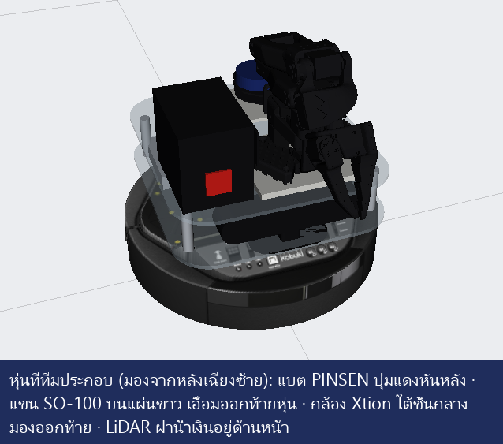
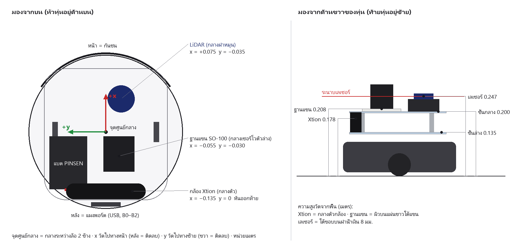
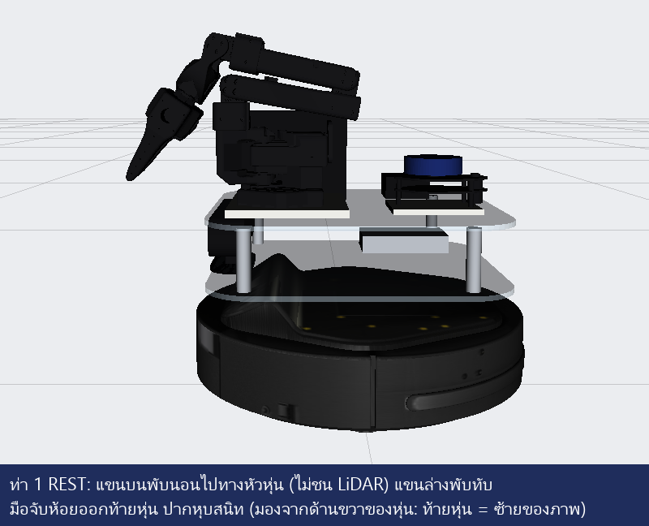
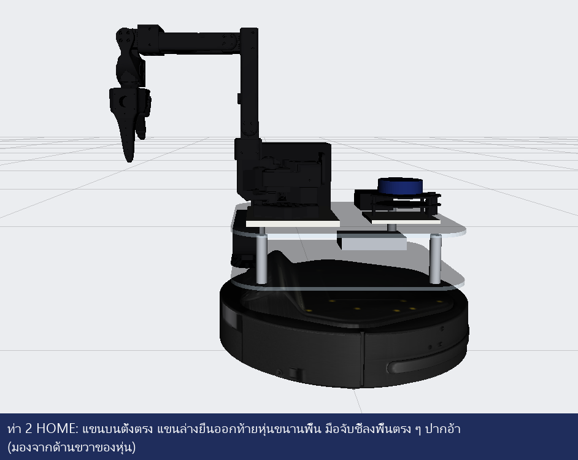
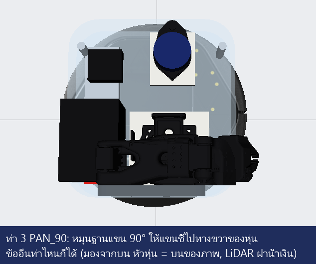

# วันเดโม 1 พ.ย. — ประกอบ → ตั้งค่า → วิ่งภารกิจ (เช็คลิสต์พร้อมรูป)

> **วันจริงใช้ [REAL_DAY_TH.md](REAL_DAY_TH.md)** (ทุกคำสั่งเรียงรวดเดียว เลขหน้าต่างเดียวกันทั้งวัน) ไฟล์นี้เก็บรูปและคำอธิบายละเอียดของแต่ละขั้น

คู่มือนี้ใช้ **วันที่ได้หุ่นจริง** ทำตามลำดับ 0 → 10 ทุกขั้นมี **✅ ผ่านเมื่อ** และรูปไว้เทียบว่าทำถูกไหม
ก่อนวันจริงให้ซ้อมกับหุ่นปลอมจนผ่านครบก่อน ([PRACTICE_NO_ROBOT_TH.md](PRACTICE_NO_ROBOT_TH.md) ภาค 1–5)

**กติกาคำสั่ง:** ในคู่มือนี้เขียนแบบ Windows (`pixi run ...` ในโฟลเดอร์โปรเจกต์)
Ubuntu: ตัด `pixi run` ออก, ตัด `robot\` ออก, ใช้ `python3` แทน `python` และอยู่ในโฟลเดอร์ `~/kobuki-pick-place/robot`
เช่น `pixi run python robot\arm_control.py rest` → `python3 arm_control.py rest`

| ขั้น | ทำอะไร | เวลาโดยประมาณ |
|---|---|---|
| 0–1 | เช็คของ + ประกอบ | 45 นาที |
| 2 | วัดตำแหน่ง แก้ `kobuki_x2.urdf` | 15 นาที |
| 3–4 | เสียบสาย เช็ค LiDAR + Kobuki | 10 นาที |
| 5 | แขน: คาลิเบรต + ลองขยับ | 25 นาที |
| 6 | กล้อง: เปิด + หาสี + เช็คมุม | 25 นาที |
| 7 | ทำแผนที่ + จดพิกัด Station | 25 นาที |
| 8 | ซ้อมวิ่ง → ภารกิจเต็ม | 30 นาที+ |
| 11 | (ไม่บังคับ) ดู/ขับหุ่นจากอีกเครื่อง: Foxglove + VS Code Remote-SSH | 15 นาที |

---

## 0. ของที่ต้องเอาไป

- [ ] โน้ตบุ๊กที่ลงโปรเจกต์แล้ว (เปิด `pixi run ros2 topic list` ได้) + สายชาร์จ
- [ ] Kobuki ชาร์จเต็ม + สาย USB ของ Kobuki
- [ ] YDLIDAR X2 + กล่องแปลง USB สีดำ (CP210x) + สาย
- [ ] แขน SO-100 + บอร์ดคุมเซอร์โว + สาย USB ของบอร์ด
- [ ] แบต PINSEN ชาร์จเต็ม + สายไฟ DC เข้าบอร์ดเซอร์โว
- [ ] กล้อง ASUS Xtion PRO LIVE (ต่อเข้าพอร์ต USB ของโน้ตบุ๊กตรง ๆ ไม่ผ่าน hub ถ้าทำได้)
- [ ] **เว็บแคม USB สำรอง** (ถ้า Xtion ไม่ยอมเปิด ใช้แทนได้ทันที ขั้น 6.2)
- [ ] USB hub แบบมีไฟเลี้ยง (Kobuki + LiDAR + บอร์ดแขน + กล้อง = 4 พอร์ต)
- [ ] ตลับเมตร + ไม้บรรทัด + เทปกาวกระดาษ (มาร์คจุดวางวัตถุ)
- [ ] ลูกบาศก์ 4 ซม. สีสด + แผ่นจุดวาง ~10 ซม. คนละสีกับลูกบาศก์ และคนละสีกับพื้น
- [ ] ไขควง น็อต สายรัด เทปสองหน้า

---

## 1. ประกอบให้ตรงกับโมเดล



| ชิ้น | วางตรงไหน | สำคัญเพราะ |
|---|---|---|
| ด้านหน้า / ด้านหลัง | **หน้า = กันชน** (ทางที่ Kobuki วิ่ง) · **หลัง = แผงพอร์ต** USB, B0–B2 | โค้ดทั้งหมดคิดแบบนี้ |
| แขน SO-100 | บนแผ่นขาว ชั้นกลาง ค่อนไปหลัง เยื้องขวาเล็กน้อย **ฐานหันออกท้ายหุ่น** | หุ่น **ถอยหลัง** เข้าหาวัตถุ แล้วแขนเอื้อมออกท้าย |
| กล้อง Xtion | บนชั้นล่าง ใต้ชั้นกลาง ท้ายหุ่น **หันออกท้าย** ตั้งตรง (ไม่ก้มไม่เงย) | กล้องต้องมองทางเดียวกับแขน |
| LiDAR X2 | บนขายึดขาว ชั้นกลาง ค่อนไปหน้า เยื้องขวา ด้านมอเตอร์หันไปหน้า | มุมเลเซอร์ calibrate ไว้แล้ว (18 ต.ค.) ต้องหันแบบเดิม |
| แบต PINSEN | ชั้นกลาง ด้านหลังซ้าย ปุ่มแดงหันหลัง | ไฟเลี้ยงแขน |

- [ ] **สายทุกเส้นต้องไม่ผ่านหน้าเลเซอร์** (ระนาบเลเซอร์สูง ~0.25 ม. จากพื้น) และไม่บังหน้ากล้อง
- [ ] สายไม่พันข้อแขน: ขยับแขนด้วยมือช้า ๆ (ตอนยังไม่เปิดไฟ) ให้ครบทุกท่าในขั้น 5 แล้วดูว่าสายไม่ตึง
- [ ] **Kobuki ไม่มีกันชนด้านหลัง** หุ่นถอยเข้าหาวัตถุเองโดยไม่มีอะไรกันชน → ด้านหลังจุดวางวัตถุต้องโล่ง

✅ ผ่านเมื่อ: หุ่นจริงหน้าตาเหมือนรูป (มองจากหลังเฉียงซ้าย)

---

## 2. วัดตำแหน่ง แล้วแก้ `kobuki_x2.urdf`

ตำแหน่งในไฟล์ประมาณจากรูปถ่าย **ต้องวัดของจริง** เพราะแขนต้องรู้ว่าวัตถุอยู่ตรงไหนเทียบกับฐานแขน (คลาด 2 ซม. = หยิบพลาด)



จุดศูนย์กลาง = กลางระหว่างล้อ 2 ข้าง (ใช้ไม้บรรทัดพาดระหว่างดุมล้อ) · x = ไปทางหน้า (ไปทางหลัง = ติดลบ) · y = ไปทางซ้าย (ขวา = ติดลบ) · z = สูงจากพื้น · หน่วยเมตร

| วัดอะไร | แก้บรรทัดไหนใน `robot/kobuki_x2.urdf` | ค่าตอนนี้ `xyz` |
|---|---|---|
| กลางฝาหมุน LiDAR (z = ใต้ขอบบนฝาน้ำเงิน 8 มม.) | `<joint name="laser_joint">` → `<origin xyz=...>` (**ห้ามแก้ rpy**) | `0.075 -0.035 0.247` |
| กลางเซอร์โวตัวล่างของแขน (z = ผิวบนแผ่นขาว) | `<joint name="so100_mount_joint">` → `xyz` | `-0.055 -0.03 0.208` |
| กลางตัวกล้อง Xtion | `<joint name="camera_joint">` → `xyz` (มุมก้มค่อยให้ขั้น 6.4 หาให้) | `-0.135 0 0.1775` |

แก้แล้ว **ปิด-เปิด `robot_model.launch.py` ใหม่** ทุกครั้ง โค้ดแขน (`arm_control.py`) ภารกิจ (`mission_nav2.py`) และ LiDAR อ่านค่าจากไฟล์นี้เอง ไม่ต้องแก้ที่อื่น

เช็คในหน้าจอ:
```powershell
pixi run ros2 launch robot\robot_model.launch.py
pixi run rviz2                      # อีกหน้าต่าง: Fixed Frame = base_link, Add > RobotModel (Description Topic /robot_description, Durability Transient Local)
pixi run ros2 run tf2_ros tf2_echo base_link laser     # อีกหน้าต่าง: ต้องได้ xyz ตามที่วัด
```

✅ ผ่านเมื่อ: `tf2_echo` ได้ค่าตรงกับที่วัด และหุ่นใน RViz หน้าตาตรงกับของจริง

---

## 3. เสียบสาย + เช็คพอร์ต

| อุปกรณ์ | Windows (Device Manager > Ports) | Ubuntu |
|---|---|---|
| Kobuki | `USB Serial Port` (FTDI) เช่น COM10 | `/dev/ttyUSB0` หรือ `1` |
| LiDAR | `Silicon Labs CP210x` เช่น COM11 | `/dev/ttyUSB0` หรือ `1` |
| บอร์ดแขน | `USB-SERIAL CH340` / `CH343` (หาเองจาก VID 1A86) | `/dev/ttyACM0` (หรือ `ttyUSB*`) |
| Xtion | `PrimeSense` / `Xtion` (ไม่ใช่พอร์ต COM) | `lsusb` เห็น `PrimeSense` |

- Windows: สคริปต์หาพอร์ตเองทุกตัว ไม่ต้องใส่เลข COM (ถ้าหาไม่เจอค่อยใส่ `--port COMx` / `-p port:=COMx`)
- Ubuntu: ครั้งแรกต้อง `sudo usermod -aG dialout $USER` แล้ว logout/login · ใน VMware ต้อง Connect ทุกอุปกรณ์ที่เมนู VM > Removable Devices
- Ubuntu ดูว่าตัวไหนพอร์ตไหน: `ls -l /dev/serial/by-id/`

✅ ผ่านเมื่อ: เห็นครบ 4 อุปกรณ์

---

## 4. LiDAR + Kobuki

ทำตาม [RUN_GUIDE_TH.md](RUN_GUIDE_TH.md) ขั้น 2–3 (หน้าต่าง 1 LiDAR `--mirror`, หน้าต่าง 2 Kobuki `--enable-motion`)

LiDAR อยู่ข้างแขนกับแบต เลเซอร์จึงโดนตัวหุ่นเอง (ไกลสุด ~0.29 ม. จากเลเซอร์) ตัว `lidar_ros2.py` ตัดจุดที่อยู่ในรัศมี 0.24 ม. จากกลางหุ่นทิ้งให้เอง หน้าต่าง 1 ต้องขึ้น:
```
Dropping returns within 0.24 m of the robot centre (laser at x=0.075 y=-0.035 in kobuki_x2.urdf)
First complete scan: ... valid returns
```
เปิด RViz (Fixed Frame `base_link`, LaserScan `/scan` Reliability Best Effort) ดูว่า **ไม่มีจุดแดงบนตัวหุ่นหรือชิดตัวหุ่น**
ถ้ายังมี (เช่น สายห้อย หรือแขนท่าอื่น) เพิ่มรัศมี: `pixi run python robot\lidar_ros2.py --mirror --self-radius 0.28`

✅ ผ่านเมื่อ: เห็นกำแพงรอบห้องเป็นจุดแดง ไม่มีจุดบนตัวหุ่น · Kobuki ขึ้น `Motion ready`

---

## 5. แขน SO-100

### 5.1 ไฟเลี้ยง

- เสียบแบต PINSEN เข้าบอร์ดเซอร์โว **ก่อน** เสียบ USB
- เซอร์โว STS3215 มี 2 รุ่น: **7.4 V** (ชุดมาตรฐาน SO-100 ใช้ไฟ ~5–7.4 V) กับ **12 V** ดูสติกเกอร์ใต้เซอร์โว ไฟจากแบตต้องตรงรุ่น
- ไดรเวอร์บอกแรงดันตอนเปิด (`supply ... V`) และเตือนถ้าตกลงเกิน 15% ระหว่างทำงาน (แบตอ่อน / ปลั๊กหลวม)

### 5.2 คาลิเบรต (ครั้งเดียว หลังประกอบแขนเสร็จ)

โปรแกรมปล่อยแรงบิด (แขนอ่อน) ให้จัดท่าด้วยมือ 3 ท่า มันอ่านค่าเซอร์โวแล้วคำนวณว่าแต่ละข้อหมุนทางไหน ศูนย์อยู่ตรงไหน

```powershell
pixi run python robot\so100_calibrate.py
```
**ประคองแขนไว้ก่อนกด Enter** แรงบิดหายแล้วแขนจะตกด้วยน้ำหนักตัวเอง

| ท่า 1 REST | ท่า 2 HOME | ท่า 3 PAN_90 |
|---|---|---|
|  |  |  |
| ฐานหันออกท้าย พับสุด มือห้อยออกท้าย ปากหุบสนิท | แขนบนตั้งตรง แขนล่างยื่นออกท้ายขนานพื้น มือชี้ลง ปากอ้า ~60° | หมุนฐาน 90° ให้แขนชี้ไปทาง **ขวา** ของหุ่น (ยกแขนให้พ้นแบต) |

ผลที่ควรได้: `saved ...so100_calibration.yaml` ไม่มี `WARNING`
- `WARNING: ... moved 40 deg ... expected 90 deg` = จัดท่าไม่ตรงรูป → รันใหม่
- `WARNING: ... would cross the servo's 0/4095 point` = ข้อนั้นใช้ได้ แต่ท่าที่ใกล้ปลายจะถูกปฏิเสธ ถ้าแขนติดตอนหยิบ ต้องประกอบฮอร์นเซอร์โวใหม่ (เรื่องใหญ่ ทำเฉพาะถ้าจำเป็น)
- อยากลองก่อนวันจริง (ไม่มีแขน): `pixi run python robot\so100_calibrate.py --mock` ต้องขึ้น `sign ok` ทุกข้อ

ไฟล์ `robot/so100_calibration.yaml` เก็บไว้ ไม่ต้องคาลิเบรตใหม่ถ้าไม่ได้ถอดแขน

### 5.3 เปิดไดรเวอร์ แล้วลองขยับทีละคำสั่ง

วางแขนท่า REST ก่อน แล้วเปิด 2 หน้าต่าง:
```powershell
pixi run ros2 launch robot\robot_model.launch.py arm:=none
pixi run python robot\so100_driver.py
```
✅ หน้าต่างไดรเวอร์ขึ้น `SO-100 ready, supply 7.4 V, torque on, holding: shoulder_pan=+0.00, shoulder_lift=-3.32, ...`
(ค่าใกล้ท่า REST: lift ≈ −3.3, elbow ≈ +3.1 ถ้าห่างมาก = คาลิเบรตผิด ให้กด Ctrl+C แล้วคาลิเบรตใหม่)

หน้าต่างที่ 3 ลองทีละบรรทัด **มือหนึ่งพร้อมดึงปลั๊กแบตแขน** ถ้าแขนวิ่งผิดทาง:

| คำสั่ง (`pixi run python robot\arm_control.py ...`) | แขนต้องทำ |
|---|---|
| `carry` | ยกขึ้นท่าถือของ ปากหุบ |
| `open` แล้ว `close` | ปากอ้า แล้วหุบ |
| `reach -0.27 0.0 0.10` | จุดกลางปากคีบไปอยู่หลังกลางหุ่น 27 ซม. สูงจากพื้น 10 ซม. |
| `reach -0.27 0.0 0.03` | ลงไปสูงจากพื้น 3 ซม. (เอาไม้บรรทัดวัด คลาดไม่เกิน 1 ซม.) |
| `rest` | กลับท่าพับ |

ทุกคำสั่งจบด้วย `done` · `reach` ยังพิมพ์มุมข้อต่อ และ `error ... mm` (ความคลาดของ IK)
- วัดแล้วคลาดเกิน 1 ซม. ทุกครั้งไปทางเดียวกัน = ตำแหน่ง `so100_mount_joint` ผิด → วัดใหม่ (ขั้น 2)
- ข้อไหนวิ่งกลับทาง = sign ผิด → คาลิเบรตใหม่ ระวังท่า 2, 3 ให้ตรงรูป

ลองหยิบด้วยมือ: วางลูกบาศก์ที่ 27 ซม. หลังกลางหุ่น แล้ว `open` → `reach -0.27 0.0 0.02` → `close` → `reach -0.27 0.0 0.10` = ลูกบาศก์ต้องลอยขึ้น

หยุดไดรเวอร์ด้วย Ctrl+C: **แรงบิดยังเปิดค้าง** (แขนไม่ตก) ถ้าจะปล่อยแขนให้อ่อน ประคองแขนแล้ว `pixi run python robot\so100_calibrate.py --relax`

✅ ผ่านเมื่อ: ทุกคำสั่งในตาราง `done` และลูกบาศก์ลอยขึ้น

---

## 6. กล้อง

### 6.1 Xtion (OpenNI2)

ติดตั้งครั้งเดียว (ทำได้ก่อนวันจริง ไม่ต้องมีกล้อง):
- Windows: ลง OpenNI2 (ตัวติดตั้ง OpenNI 2 SDK สำหรับ Windows x64) แล้วในโฟลเดอร์โปรเจกต์ `pixi add --pypi openni`
- Ubuntu: `sudo apt install libopenni2-0 openni2-utils` และ `pip3 install openni`

เปิด:
```powershell
pixi run python robot\camera_node.py
```
Windows ถ้าขึ้นว่าหา `OpenNI2.dll` ไม่เจอ: `... camera_node.py --ros-args -p openni_path:="C:\Program Files\OpenNI2\Redist"`
✅ ขึ้น `openni camera 640x480, fx=577 -> /camera/color/image_raw` และ RViz (Add > Image `/camera/color/image_raw`) เห็นภาพ

### 6.2 สำรอง: เว็บแคม USB (ถ้า Xtion เปิดไม่ได้ภายใน 15 นาที ใช้ทางนี้เลย)

```powershell
pixi run python robot\camera_node.py --list                                        # หาเลขกล้อง: device 1: OK 640x480
pixi run python robot\camera_node.py --ros-args -p backend:=opencv -p device:=1 -p hfov_deg:=60
```
ติดเว็บแคมแทนที่ Xtion (ท้ายหุ่น หันออกท้าย) แล้ว **วัดกลางเลนส์ใส่ `camera_joint` ใหม่** · `hfov_deg` = มุมมองแนวนอนของเว็บแคม (ดูสเปก ปกติ 60–78) ขั้น 6.4 จะช่วยแก้ส่วนที่คลาด

### 6.3 หาสีลูกบาศก์ + จุดวาง

เปิดกล้องค้างไว้ แล้ว:
```powershell
pixi run python robot\hsv_tuner.py
```
วางลูกบาศก์ให้อยู่ในภาพ → กด `1` แล้ว **คลิกที่ลูกบาศก์** → ภาพขวาต้องเป็นก้อนขาวเฉพาะลูกบาศก์ → กด `2` คลิกแผ่นจุดวาง → กด `q`
มันพิมพ์บรรทัด `-p cube_hsv_low:=[...] -p cube_hsv_high:=[...] -p marker_hsv_low:=...` ไว้ใช้กับ `cube_detector.py`


- ก้อนขาวมีรู → ลด S min / V min ด้วยแถบเลื่อน · มีจุดขาวที่อื่น (พื้น ผนัง) → เพิ่ม S min
- ไฟห้องเปลี่ยน (ปิดม่าน/เปิดไฟ) ต้องหาสีใหม่ → หาสีใต้ไฟเดียวกับตอนเดโม

### 6.4 เช็คมุมกล้องด้วยตลับเมตร

กล้องตั้งตรงมองเห็นพื้นได้ตั้งแต่ ~0.58 ม. หลังกลางหุ่น หุ่นจอดห่างวัตถุ 0.65 ม. แล้วค่อยถอยเข้าไป จึงต้องวัดที่ระยะนั้น

1. เปิด `robot_model.launch.py arm:=none`, กล้อง, และตัวหา (ใส่สีจาก 6.3):
   ```powershell
   pixi run python robot\cube_detector.py --ros-args -p cube_hsv_low:=[...] -p cube_hsv_high:=[...] -p marker_hsv_low:=[...] -p marker_hsv_high:=[...]
   ```
2. วางลูกบาศก์ **หลังกลางหุ่น 0.65 ม. ตรงแนวกลาง** (ใช้ตลับเมตร + เทปมาร์ค)
3. ```powershell
   pixi run python robot\camera_check.py -0.65 0.0 --write
   ```
4. ปิด-เปิด `robot_model.launch.py` ใหม่ แล้วรันข้อ 3 อีกรอบ (ไม่ต้องใส่ `--write`)

ผลจริงจากซิม (แกล้งให้กล้องก้ม 5° เอียง 2°):
```
camera sees the cube at x=-0.817 y=+0.040, you measured x=-0.634 y=-0.002 -> off by 18.8 cm
camera is tilted +4.8 deg more down and turned +2.2 deg more left than kobuki_x2.urdf says
camera_joint rpy: "0 0 3.14159"  ->  "0 0.084 3.180"
saved kobuki_x2.urdf (old one: kobuki_x2.urdf.bak) - restart robot_model.launch.py and check again
```
รอบสอง: `... -> off by 0.1 cm` / `good enough (< 1 cm), nothing to change`

ภาพที่กล้องควรเห็นตอนหุ่นจอดหน้า Station 1 (กรอบแดง = ตัวหาเจอ, ลูกบาศก์อยู่ล่างภาพ):


✅ ผ่านเมื่อ: `camera_check.py` รอบสองคลาดไม่เกิน 1 ซม.

---

## 7. แผนที่ห้องจริง + พิกัด Station

1. **วางหุ่นที่ Initial Location หันทางเดียวกับตอนเริ่มเดโม** แล้วทำแผนที่ตาม [RUN_GUIDE_TH.md](RUN_GUIDE_TH.md) ขั้น 4–8 (จุดเริ่มทำแผนที่ = (0, 0) ของแผนที่ = HOME)
2. เซฟแผนที่ ปิด SLAM เปิด Nav2 ด้วยแผนที่นั้น (RUN_GUIDE ขั้น 9)
3. ใน RViz กด **Publish Point** แล้วคลิกตรงที่ **วางลูกบาศก์** (Station 1) และตรงที่ **แผ่นจุดวาง** (Station 2) ดูค่า x, y:
   ```powershell
   pixi run ros2 topic echo /clicked_point
   ```
4. แก้ใน `robot/mission_nav2.py`:
   ```python
   STATIONS = {"STATION1": (5.30, 1.32, 0.0), "STATION2": (2.85, -2.90, -math.pi / 2)}
   #                       (x วัตถุ, y วัตถุ, ทิศที่หุ่นถอยเข้าหา)
   ```
   - x, y = ตำแหน่ง **วัตถุ** (ไม่ใช่จุดจอด) โปรแกรมคำนวณจุดจอดให้เอง: ห่างวัตถุ 0.65 ม. ท้ายหุ่นหันเข้าหาวัตถุ
   - ทิศ (เรเดียน) = ทิศจากจุดจอดไปหาวัตถุ: `0` = วัตถุอยู่ทาง +x ของจุดจอด, `math.pi / 2` = ทาง +y, `-math.pi / 2` = ทาง −y, `math.pi` = ทาง −x
   - เลือกทิศที่ **พื้นก่อนถึงวัตถุโล่งอย่างน้อย 0.9 ม.** (ที่จอด + ที่ถอย)
5. ลองให้ Nav2 วิ่งอย่างเดียว:
   ```powershell
   pixi run python robot\mission_nav2.py --nav-only
   ```
   ✅ หุ่นไปจอดหน้า Station 1 (ท้ายหันเข้าวัตถุ) → Station 2 → กลับบ้าน จบด้วย `Mission finished: succeeded`

---

## 8. ภารกิจเต็ม

| หน้าต่าง | Windows | Ubuntu (ใน `robot/`) |
|---|---|---|
| 1 LiDAR | `pixi run python robot\lidar_ros2.py --mirror` | `python3 lidar_ros2.py --mirror` |
| 2 Kobuki | `pixi run python robot\kobuki_ros2.py --enable-motion` | `python3 kobuki_ros2.py --enable-motion` |
| 3 โมเดล | `pixi run ros2 launch robot\robot_model.launch.py arm:=none` | `ros2 launch ./robot_model.launch.py arm:=none` |
| 4 แขน | `pixi run python robot\so100_driver.py` | `python3 so100_driver.py --ros-args -p port:=/dev/ttyACM0` |
| 5 กล้อง | `pixi run python robot\camera_node.py` | `python3 camera_node.py` |
| 6 ตัวหา | `pixi run python robot\cube_detector.py --ros-args -p cube_hsv_low:=[...] ...` | `python3 cube_detector.py --ros-args -p ...` |
| 7 Nav2 | `pixi run ros2 launch robot\nav2.launch.py map:=$HOME\maps\my_map.yaml` | `ros2 launch ./nav2.launch.py map:=$HOME/maps/my_map.yaml` |
| 8 RViz | `pixi run rviz2 -d robot\mission.rviz` | `rviz2 -d mission.rviz` |
| 10 เสียงหุ่น | `pixi run python robot\announcer.py` | `python3 announcer.py` |
| 9 ภารกิจ | `pixi run python robot\mission_nav2.py` | `python3 mission_nav2.py` |

เปิดตามลำดับ วางแขนท่า REST ก่อนเปิดหน้าต่าง 4 · รอหน้าต่าง 7 ขึ้น `Activating bt_navigator` ก่อนเปิดหน้าต่าง 9

**หน้าต่าง 10 เสียงหุ่น (ไม่บังคับ แต่ช่วยกรรมการให้คะแนน):** เปิดก่อนหน้าต่าง 9 ต้องได้ยิน "หุ่นยนต์พร้อมแล้ว" (= ลำโพงใช้ได้ เปิดเสียงโน้ตบุ๊กให้ดังสุด)
ระหว่างภารกิจหุ่นจะพูดทุกขั้นที่มีคะแนน: "ถึงสถานีที่หนึ่งแล้ว" → "เจอวัตถุแล้ว" → "หยิบวัตถุสำเร็จ" → "ถึงสถานีที่สองแล้ว" → "เจอจุดวางแล้ว" → "วางวัตถุเรียบร้อย" → "กลับถึงจุดเริ่มต้นแล้ว"
หน้าต่างนี้แค่พูด ไม่สั่งหุ่น ถ้าไม่มีเสียง ภารกิจก็วิ่งได้ปกติ · ไม่ต้องใช้เน็ต (เสียงอัดไว้แล้วใน `robot/sounds/`) · แก้ประโยคได้ที่ `robot/voice_lines.py` แล้วรัน `tools/make_voice.py`
ถ้าเลเซอร์ไม่ทับกำแพงใน RViz: กด **2D Pose Estimate** ที่ตำแหน่งหุ่นจริง

สิ่งที่หุ่นทำ (ผลจริงจากซิม หุ่นแบบประกอบจริง ถอยเข้าวัตถุบนพื้น 28 ต.ค.):
```
[NAV_STATION1] go to STATION1 x=4.65 y=1.32 yaw=180 deg          <- จุดจอด ห่างลูกบาศก์ 0.65 ม.
[NAV_STATION1] arrived in 57 s
[DETECT_OBJECT] cube at x=5.301 y=1.322 (odom) = -0.64 m ahead, +0.15 m left of the robot
  approach: cube is 0.65 m behind, driving -0.38 m                <- ถอยเข้า
  cube is now too close for the camera - using where it was seen before
[PICK] cube at -0.273 +0.006 0.020 (base_link) - moving the arm
[PICK] done
[NAV_STATION2] go to STATION2 x=2.85 y=-2.25 yaw=90 deg
[DETECT_STATION] station at x=2.858 y=-2.908 (odom) = -0.61 m ahead, +0.17 m left of the robot
  approach: station is 0.64 m behind, driving -0.37 m
[PLACE] station at -0.273 +0.006 0.000 (base_link) - moving the arm
[PLACE] done
[RETURN_HOME] arrived in 64 s
Mission finished: succeeded in 229 s
```
("ahead" ติดลบ = อยู่หลังหุ่น ถูกต้องเพราะกล้องมองออกท้าย)


---

## 9. ถ้ามีปัญหา

| อาการ | ทำอะไรก่อน |
|---|---|
| Xtion เปิดไม่ได้ / `camera gives no picture` | ถอดเสียบใหม่ (พอร์ตตรงของโน้ตบุ๊ก ไม่ผ่าน hub) → ไม่ได้ใน 15 นาที ใช้เว็บแคม (6.2) แล้วทำ 6.3–6.4 ใหม่ |
| `servos not answering: [...]` | ไฟแบตเข้าบอร์ดไหม · สายเซอร์โวหลวมตรงข้อที่บอก (ต่อกันเป็นโซ่ ข้อแรกหลุด = ข้อถัดไปหายหมด) |
| `SO-100 servo board not found` | สาย USB บอร์ด · Windows ใส่ `--ros-args -p port:=COMx` |
| แขนกระตุก / `supply dropped to ...` | แบตอ่อน หรือปลั๊ก DC หลวม |
| แขนวิ่งไปผิดที่ตลอด | วัด `so100_mount_joint` ใหม่ (ขั้น 2) · ทดสอบ `reach` ด้วยไม้บรรทัด (5.3) |
| `[DETECT_OBJECT] no cube in the camera image` | ดูช่อง Camera ใน RViz: เห็นลูกบาศก์ไหม → ไม่เห็น = จุดจอด/ทิศใน `STATIONS` ผิด · เห็นแต่ไม่มีกรอบแดง = หาสีใหม่ (6.3) |
| `target ... out of reach` | ลูกบาศก์ไกล/ใกล้เกิน: เอื้อมถึงพื้นได้ 0.20–0.32 ม. หลังกลางหุ่น · เช็ค `camera_check.py` (6.4) |
| หุ่นถอยแล้วชน | ด้านหลังวัตถุไม่โล่ง หรือทิศใน `STATIONS` ทำให้ถอยผ่านสิ่งของ → เปลี่ยนทิศ |
| Nav2 หมุนวน / ไปไม่ถึง | 2D Pose Estimate ใหม่ · ดู costmap ว่ามีจุดดำรอบตัวหุ่นไหม (มี = เพิ่ม `--self-radius`) |
| `blocked while driving straight` | ล้อติด / ชนอะไรอยู่ / Kobuki ไม่ได้ใส่ `--enable-motion` |
| หยุดทุกอย่างทันที | Ctrl+C หน้าต่าง 9 แล้ว 2 (ล้อหยุด) · แขนค้างท่าเดิม (แรงบิดเปิดอยู่) |

---

## 10. เช็คลิสต์ก่อนกรรมการมา

- [ ] หุ่นประกอบตรงรูปขั้น 1 สายไม่ผ่านหน้าเลเซอร์/กล้อง
- [ ] `kobuki_x2.urdf` ใส่ค่าที่วัดจริงแล้ว (laser, แขน, กล้อง)
- [ ] LiDAR: ไม่มีจุดบนตัวหุ่นใน RViz
- [ ] แขน: คาลิเบรตแล้ว `reach -0.27 0.0 0.03` คลาดไม่เกิน 1 ซม. และหยิบด้วยมือได้ (5.3)
- [ ] กล้อง: ใส่สีจาก `hsv_tuner.py` แล้ว `camera_check.py` คลาด < 1 ซม.
- [ ] แผนที่ห้องจริง + `STATIONS` ใส่ตำแหน่งวัตถุจริง
- [ ] `--nav-only` จบด้วย `succeeded`
- [ ] ภารกิจเต็มจบด้วย `succeeded` อย่างน้อย 1 รอบ
- [ ] (ถ้าใช้เสียง) เปิดหน้าต่าง 10 ได้ยิน "หุ่นยนต์พร้อมแล้ว" เสียงโน้ตบุ๊กดังสุด
- [ ] แบต Kobuki / แบตแขน / โน้ตบุ๊ก ชาร์จระหว่างรอ
- [ ] มาร์คจุด Initial, ลูกบาศก์, จุดวาง ด้วยเทปบนพื้น วางให้ตรงทุกรอบ

---

## 11. (ไม่บังคับ) ดูและสั่งหุ่นจากอีกเครื่อง: Foxglove + VS Code Remote-SSH

โน้ตบุ๊กยังวางบนหุ่นและเสียบสาย USB เหมือนเดิม (Kobuki กับ LiDAR ต่อไร้สายไม่ได้) แต่คนในทีมยืนห่าง ๆ แล้ว
**ดูแผนที่/เลเซอร์/กล้อง และขับหุ่นจากเบราว์เซอร์หรือมือถือ** (Foxglove) และ **เปิด terminal ของโน้ตบุ๊กหุ่นจากเครื่องตัวเอง** (VS Code Remote-SSH)

> ⚠️ ภารกิจต้องรันได้โดยไม่พึ่งไวไฟ ถ้าไวไฟห้องสอบมีปัญหา ข้ามข้อนี้ไปเลย ใช้โน้ตบุ๊กบนหุ่นตามขั้น 0–10
> ทั้งสองเครื่องต้องต่อไวไฟวงเดียวกัน แนะนำ **ฮอตสปอตมือถือ** (ไวไฟมหาลัยมักบล็อกไม่ให้เครื่องเห็นกัน)

**หาเลข IP ของโน้ตบุ๊กหุ่น:** PowerShell พิมพ์ `ipconfig` ดูบรรทัด `IPv4 Address` ใต้ `Wireless LAN adapter Wi-Fi` เช่น `192.168.43.25`

### 11.1 Foxglove: ดู + ขับหุ่นจากเบราว์เซอร์/มือถือ

ทดสอบกับหุ่นปลอมแล้ว 31 ต.ค.: ข้อมูลออกครบ 31 topic (เลเซอร์ 4 Hz, odom 50 Hz, แผนที่, กล้อง, โมเดลหุ่น) และสั่งหมุนหุ่นผ่าน Teleop ได้

**บนโน้ตบุ๊กหุ่น** เปิดเพิ่ม 2 หน้าต่าง (ตอนไหนก็ได้ หลังขั้น 4):
```powershell
pixi run ros2 launch robot\foxglove.launch.py
```
✅ `Starting foxglove_bridge (humble, 3.6.0...)` · ครั้งแรก Windows Firewall จะถาม → ติ๊ก **Private networks** → **Allow access**
```powershell
pixi run python robot\image_compress.py
```
✅ `JPEG copy of /camera/color/image_raw on /camera/color/image_raw/compressed`
(ภาพกล้องดิบใช้เน็ต 3.4 MB/วินาที ตัวนี้ย่อเป็น JPEG เหลือ ~30 KB/วินาที ไว้ดูผ่านไวไฟ — ตัวหาวัตถุยังใช้ภาพดิบเหมือนเดิม)

**บนเครื่องที่ถือ** (คอม/แท็บเล็ต/มือถือ):
1. เปิด **app.foxglove.dev** ใน Chrome หรือแอป Foxglove (ใช้ตัวล่าสุด) อาจต้องสมัครบัญชีฟรี
2. **Open connection** → **Foxglove WebSocket** → ใส่ `ws://<IP โน้ตบุ๊กหุ่น>:8765` → **Open**
3. เพิ่มแผง (ปุ่ม **Add panel**) แล้วตั้งค่า:

| แผง | ตั้งค่า | ได้อะไร |
|---|---|---|
| **3D** | Display frame = `map` · ใน Topics ติ๊ก `/map`, `/scan`, `/global_costmap/costmap`, `/plan`, `/stations`, `/robot_description` | แผนที่ + เลเซอร์ + เส้นทาง + โมเดลหุ่น |
| **Image** | Topic = `/camera/color/image_raw/compressed` | ภาพกล้องท้ายหุ่น |
| **Teleop** | Topic = `/cmd_vel` · **Publish rate = 10** · Up: `linear-x` `0.08` · Down: `linear-x` `-0.08` · Left: `angular-z` `0.35` · Right: `angular-z` `-0.35` | จอยกดขับหุ่น (ใช้ทำแผนที่ขั้น 7 แทนคีย์บอร์ดได้) |

- **Publish rate ต้อง 10:** ไดรเวอร์ Kobuki หยุดล้อเองถ้าไม่ได้คำสั่งเกิน 0.4 วินาที ค่าเริ่มต้นที่ช้ากว่านี้จะทำให้หุ่นเดินกระตุก
- ปล่อยปุ่ม = หุ่นหยุดภายใน 0.4 วินาที · ไวไฟหลุด = หุ่นหยุดเอง
- **อย่ากด Teleop ตอนภารกิจกำลังวิ่ง** (คำสั่งจะตีกับ Nav2 และกรรมการอาจนับว่าคนช่วย)

### 11.2 VS Code Remote-SSH: terminal ของโน้ตบุ๊กหุ่นบนเครื่องตัวเอง

**บนโน้ตบุ๊กหุ่น (ครั้งเดียว ต้องใช้สิทธิ์ admin):**
1. Settings → System → **Optional features** → **View features** → ค้น `OpenSSH Server` → Install
2. เปิด PowerShell แบบ **Run as administrator**:
   ```powershell
   Start-Service sshd
   Set-Service sshd -StartupType Automatic
   ```
3. จดชื่อผู้ใช้: `whoami` (เอาส่วนหลัง `\`) · รหัสผ่าน = รหัสที่ใช้ล็อกอิน Windows (ถ้าล็อกอินด้วยบัญชี Microsoft ใช้รหัสบัญชีนั้น **ไม่ใช่ PIN**)

**บนเครื่องที่ถือ:**
1. VS Code → Extensions → ลง **Remote - SSH** (ของ Microsoft)
2. กด `F1` → `Remote-SSH: Connect to Host...` → พิมพ์ `ชื่อผู้ใช้@IP` เช่น `pomma@192.168.43.25` → เลือก **Windows** → ใส่รหัสผ่าน
3. **File → Open Folder** → โฟลเดอร์โปรเจกต์บนโน้ตบุ๊กหุ่น
4. **Terminal → New Terminal** (กด `+` เพิ่มได้หลายหน้าต่าง) → พิมพ์คำสั่งตามคู่มือได้เลย ถ้าขึ้น `C:\...>` (cmd) ให้พิมพ์ `powershell` ก่อน
5. ✅ ลอง `pixi run ros2 topic list` ต้องเห็น topic ของหุ่น

ข้อควรรู้:
- โปรแกรมที่มีหน้าต่าง (RViz, `hsv_tuner.py`) จะเปิด**บนจอโน้ตบุ๊กหุ่น** ไม่ขึ้นบนเครื่องเรา → ดูภาพผ่าน Foxglove แทน
- คีย์บอร์ดขับหุ่น (`teleop_twist_keyboard`) ใช้ใน terminal ของ VS Code ได้ (คลิกใน terminal ก่อนกด)
- ถ้า SSH หลุด คำสั่งที่รันใน terminal นั้นจะหยุดหมด (หุ่นหยุด) → **ตอนวิ่งภารกิจจริง ให้รันหน้าต่างภารกิจบนโน้ตบุ๊กหุ่นโดยตรง** ปลอดภัยกว่า
