# วันซ้อม: ทำครบทั้งภารกิจในซิม ฉบับเดียวจบ

คู่มือนี้พาทำ **ตั้งแต่เปิดคอมจนหุ่นปลอมหยิบ-วางเสร็จแล้วกลับบ้าน** ในรวดเดียว ไม่ต้องมีหุ่นจริง ใช้คอมเครื่องเดียว
ทำตามลำดับขั้น 0 → 12 ทุกขั้นมี **✅ ต้องเห็น** ไว้เทียบ ถ้าไม่เห็นตามนั้น อย่าเพิ่งไปขั้นต่อไป ดูตาราง "ถ้าติด" ท้ายไฟล์

> **รูปทุกรูปในคู่มือนี้คือภาพจริงจากการรันตามคู่มือนี้บน Windows (28 ต.ค.)** หน้าต่างดำ = terminal (ชื่อหน้าต่างบนแท็บ = เลขหน้าต่าง),
> หน้าต่างขาว = RViz · ตัวเลขเวลาใน `[INFO] [...]` ของคุณจะต่างไป ไม่เป็นไร · ตัวเลขใน RViz อาจเป็นเลขไทย (๑๒๓) ตามภาษาของ Windows

ใช้เวลาประมาณ 1.5–2 ชั่วโมง (ครั้งแรก) · ทำซ้ำได้เรื่อย ๆ จนจำลำดับได้ วันเดโมคือลำดับเดียวกัน แค่เปลี่ยนหุ่นปลอมเป็นของจริง ([DEMO_DAY_TH.md](DEMO_DAY_TH.md))

อยากรู้ลึกว่าแต่ละช่องใน RViz ตั้งยังไง ดู [PRACTICE_NO_ROBOT_TH.md](PRACTICE_NO_ROBOT_TH.md) (คู่มือนี้ใช้ไฟล์ตั้งค่าสำเร็จรูปเพื่อให้จบในวันเดียว)

---

## กติกา (อ่านก่อน 1 นาที)

- **1 คำสั่งที่รันค้าง = 1 หน้าต่าง terminal** เปิดค้างไว้ อย่าปิด หยุดด้วย `Ctrl+C` ในหน้าต่างนั้น
- **Windows** (PowerShell): ทุกหน้าต่างเริ่มด้วย `cd ~\kobuki-pick-place` แล้วพิมพ์คำสั่งในคอลัมน์ Windows (มี `pixi run` นำหน้า)
- **Ubuntu**: ทุกหน้าต่างเริ่มด้วย `source /opt/ros/humble/setup.bash` และ `cd ~/kobuki-pick-place/robot` แล้วพิมพ์คำสั่งในคอลัมน์ Ubuntu
- หน้าต่างขับหุ่นด้วยคีย์บอร์ด: **คลิกที่หน้าต่างก่อน + เปลี่ยนแป้นเป็นภาษาอังกฤษ**

ผังหน้าต่างทั้งวัน (เลขเดียวกันตลอดคู่มือ):

| หน้าต่าง | ช่วงทำแผนที่ (ขั้น 1–5) | ช่วง Nav2 + ภารกิจ (ขั้น 6–11) |
|---|---|---|
| 1 | หุ่นปลอม | หุ่นปลอม (เปิดใหม่ให้กลับจุดเริ่ม) |
| 2 | โมเดลหุ่น + แขนปลอม | (เหมือนเดิม เปิดค้าง) |
| 3 | RViz ทำแผนที่ | RViz ภารกิจ |
| 4 | SLAM | Nav2 |
| 5 | ขับด้วยคีย์บอร์ด | ภารกิจ |
| 6 | เซฟแผนที่ | กล้องปลอม |
| 7 | — | ตัวหาวัตถุ |
| 8 | สำรอง (เช็คค่า) | สำรอง (ลองแขน) |

---

## ขั้น 0 — เตรียมเครื่อง (ครั้งแรกครั้งเดียว)

ทำตาม [README.md](../README.md) ข้อ 1–2 (clone + ติดตั้ง) สรุปสั้น ๆ:

**Windows:**
```powershell
cd ~
git clone https://github.com/SSRobotic/kobuki-pick-place.git
cd kobuki-pick-place
pixi install
```
(ครั้งแรกโหลด ~0.9 GB ใช้เวลาสักพัก)

**Ubuntu 22.04:** ลง ROS 2 Humble + แพ็กเกจตาม README ข้อ 2B แล้ว `git clone` ไว้ที่ `~/kobuki-pick-place`

✅ ต้องเห็น: `pixi run ros2 topic list` (Ubuntu: `ros2 topic list`) ขึ้น `/parameter_events` กับ `/rosout`

ถ้าเคย clone แล้ว ให้ดึงของใหม่ก่อนซ้อมทุกครั้ง: `git pull`

---

## ขั้น 1 — หน้าต่าง 1: หุ่นปลอม

| Windows | Ubuntu |
|---|---|
| `pixi run python robot\fake_robot.py` | `python3 fake_robot.py` |

✅ ต้องเห็น:
```
[fake_robot]: Fake robot ready at Initial Location. Publishing /scan, /odom, TF odom -> base_link, /stations, /sim/cube
[fake_robot]:   Station 1: x=5.04 y=1.32 (odom)
[fake_robot]:   Station 2: x=2.85 y=-2.58 (odom)
[fake_robot]:   Initial: x=0.00 y=0.00 (odom)
[fake_robot]:   Cube on the floor at Station 1: x=5.3.. y=1.3.. | place marker at Station 2: x=2.85 y=-2.90
```
หุ่นปลอม = ห้องสอบจำลองตามผังในโจทย์ ส่ง `/scan` (เลเซอร์) `/odom` (ล้อ) และ TF เหมือนหุ่นจริงทุกอย่าง
มีลูกบาศก์เขียว 4 ซม. **บนพื้น** ที่ Station 1 (ตำแหน่งสุ่มเยื้อง ±3 ซม. ทุกครั้งที่เปิด) และแผ่นฟ้าบนพื้นที่ Station 2 = จุดวาง

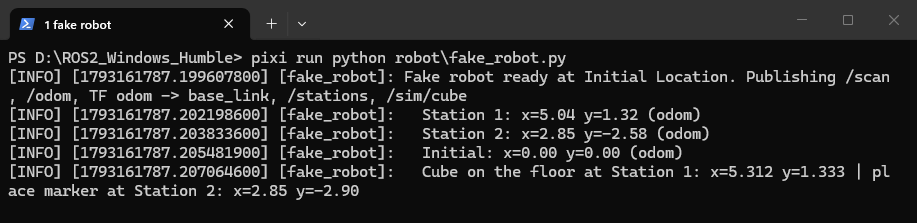
*หน้าต่าง 1 หลังเปิด: 5 บรรทัด INFO (สองบรรทัดล่างขึ้นตอนจบภารกิจในขั้น 10) · ถ้ามีบรรทัดเหลือง `New subscription ... incompatible QoS` 1 บรรทัดตอนเปิด RViz = ปกติ*

```
 ┌──────────────────────┬────────┐
 │ [desk]               │        │
 │  ● Station 1  ■ลูกบาศก์┊ประตูบน  │
 │       [  โต๊ะ  ]      │        │
 │                 [ ]  │  ● Station 2
 ├──────┐ ทางเข้า ┌──────┤  ■แผ่นฟ้า│
 │ [   ]          [ ]   │[ ]     │
 │ [ ]    ● Initial     ┊ประตูล่าง │
 │        [ FRONT ]     │        │
 └──────────────────────┴────────┘
   หุ่นเริ่มที่ Initial หันขึ้น (แกน X) ซ้ายมือ = แกน Y
```

---

## ขั้น 2 — หน้าต่าง 2: โมเดลหุ่น + แขนปลอม

| Windows | Ubuntu |
|---|---|
| `pixi run ros2 launch robot\robot_model.launch.py arm:=sim` | `ros2 launch ./robot_model.launch.py arm:=sim` |

✅ ต้องเห็น `got segment` 21 บรรทัด (base_link, battery, ..., laser, laser_cap, so100_base, ..., white_plates)
หน้าต่างนี้บอก ROS ว่าแต่ละชิ้นบนหุ่นอยู่ตรงไหน (จาก `kobuki_x2.urdf`) และ `arm:=sim` เปิดแขนปลอมที่ขยับตามคำสั่งได้ **เปิดค้างไว้ทั้งวัน**

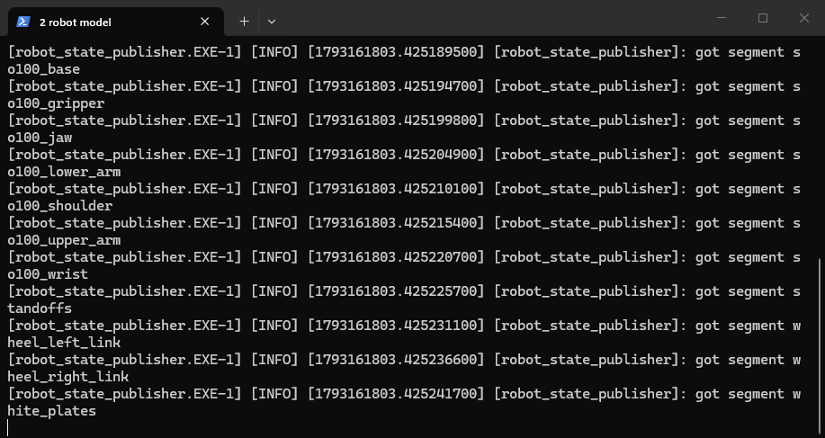
*หน้าต่าง 2: ท้ายสุดเป็นรายการ `got segment ...` (เลื่อนขึ้นดูได้ครบ 21 บรรทัด) ไม่มีบรรทัดแดง*

---

## ขั้น 3 — หน้าต่าง 8: เช็คว่าข้อมูลมาครบ

```powershell
pixi run ros2 topic hz /scan
```
✅ `average rate: 4.0...` → `Ctrl+C`

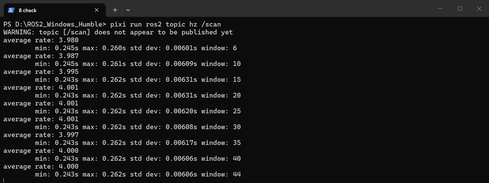
*บรรทัดแรก `WARNING: topic [/scan] does not appear to be published yet` = ปกติ (ยังไม่ทันได้ข้อมูล) แล้ว `average rate` ~4.0*

```powershell
pixi run ros2 topic hz /odom
```
✅ ประมาณ `50` → `Ctrl+C`

```powershell
pixi run ros2 run tf2_ros tf2_echo base_link laser
```
✅ `Translation: [0.075, -0.035, 0.247]` = LiDAR อยู่หน้ากลางหุ่น 7.5 ซม. สูง 24.7 ซม. → `Ctrl+C`

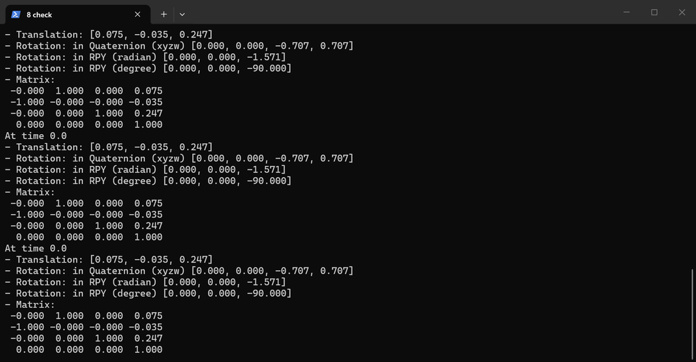
*`Translation: [0.075, -0.035, 0.247]` และ `RPY (degree) [0.000, 0.000, -90.000]` ขึ้นซ้ำทุกวินาที*

(Ubuntu: ตัด `pixi run` ออก)

---

## ขั้น 4 — ทำแผนที่: SLAM + RViz + ขับด้วยคีย์บอร์ด

**หน้าต่าง 4: SLAM**

| Windows | Ubuntu |
|---|---|
| `pixi run ros2 run slam_toolbox async_slam_toolbox_node --ros-args --params-file robot\slam_params.yaml` | `ros2 run slam_toolbox async_slam_toolbox_node --ros-args --params-file slam_params.yaml` |

✅ `Registering sensor: [Custom Described Lidar]`

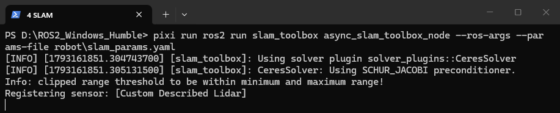
*หน้าต่าง 4: SLAM เริ่มทำงาน (Solver plugin + Registering sensor)*

**หน้าต่าง 3: RViz** (เปิดหลัง SLAM เพราะไฟล์นี้ใช้ Fixed Frame = `map` ที่ SLAM สร้าง)

| Windows | Ubuntu |
|---|---|
| `pixi run rviz2 -d robot\mapping.rviz` | `rviz2 -d mapping.rviz` |

✅ เห็นหุ่นแบบที่ทีมประกอบ: Kobuki ดำ แผ่นอะคริลิก 2 ชั้น แขนสีดำด้านหลัง LiDAR ฝาน้ำเงินด้านหน้า + จุดแดงเลเซอร์รอบห้อง + แผนที่สีเทาเริ่มขึ้นรอบตัวหุ่น

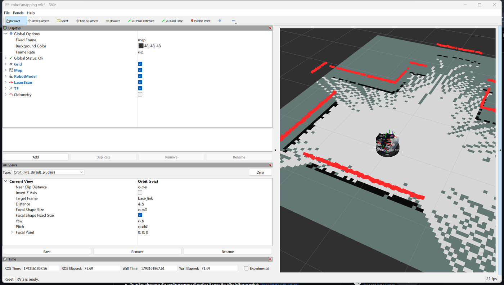
*RViz (`mapping.rviz`) ตอนเพิ่งเปิด SLAM: หุ่นอยู่กลาง จุดแดง = เลเซอร์ พื้นเทาอ่อน = ส่วนที่แผนที่รู้แล้ว ดำ = กำแพง · ซูม: scroll เมาส์ · หมุนมุมมอง: ลากซ้าย · เลื่อน: ลากกลาง/Shift+ลาก*

**หน้าต่าง 5: ขับด้วยคีย์บอร์ด**

| Windows | Ubuntu |
|---|---|
| `pixi run ros2 run teleop_twist_keyboard teleop_twist_keyboard --ros-args -p speed:=0.08 -p turn:=0.35` | `ros2 run teleop_twist_keyboard teleop_twist_keyboard --ros-args -p speed:=0.08 -p turn:=0.35` |

คลิกที่หน้าต่างนี้ + แป้นภาษาอังกฤษ แล้ว **กดค้าง**: `i` เดินหน้า · `,` ถอย · `j`/`l` หมุนซ้าย/ขวา · `k` หยุด
ชนอะไร หน้าต่าง 1 ขึ้น `Bump!` → กด `,` ถอยออก

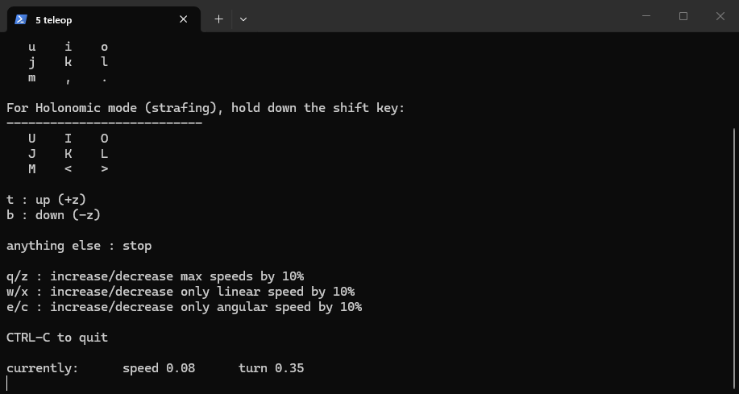
*หน้าต่าง 5: ผังปุ่ม + `currently: speed 0.08 turn 0.35` คลิกหน้าต่างนี้ก่อนกดปุ่ม*

เส้นทาง (วนครบห้องแล้วกลับจุดเดิม = แผนที่แม่นสุด):
1. ที่ Initial กด `j` หมุนช้า ๆ 1 รอบ
2. `i` ตรงขึ้นไป ~2.5 ม. ลอดทางเข้าห้องบน
3. อ้อมโต๊ะกลางไปทางซ้าย → Station 1
4. ไปทางขวา ออกประตูบน สู่ทางเดินขวา
5. ลงมาที่ Station 2
6. ลงต่อ เข้าประตูล่าง กลับห้องล่าง
7. กลับ Initial ดูใน RViz ว่ากำแพงเดิมทับกันพอดี ไม่เบลอซ้อน

ระหว่างขับ แผนที่ใน RViz จะค่อย ๆ ขยายแบบนี้ (มุมมองตามหุ่นไปเรื่อย ๆ):

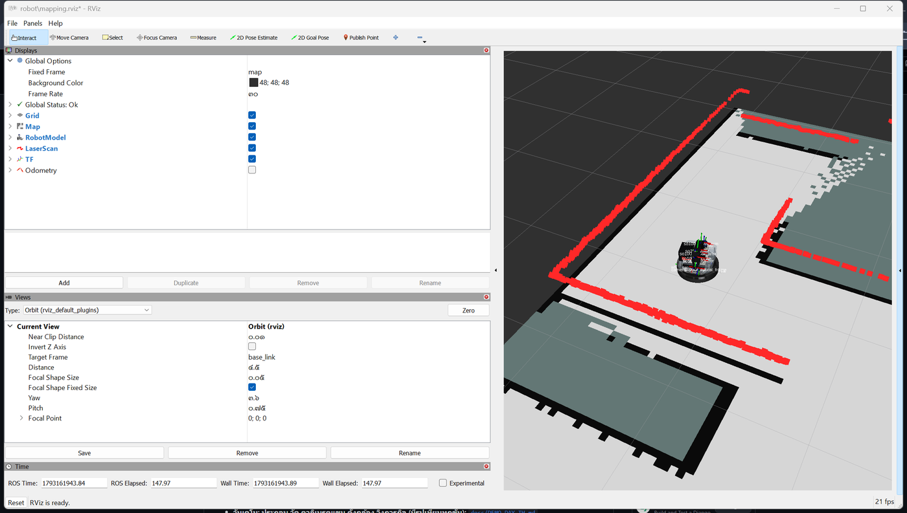
*ลอดทางเข้าห้องบนแล้ว กำลังไป Station 1*

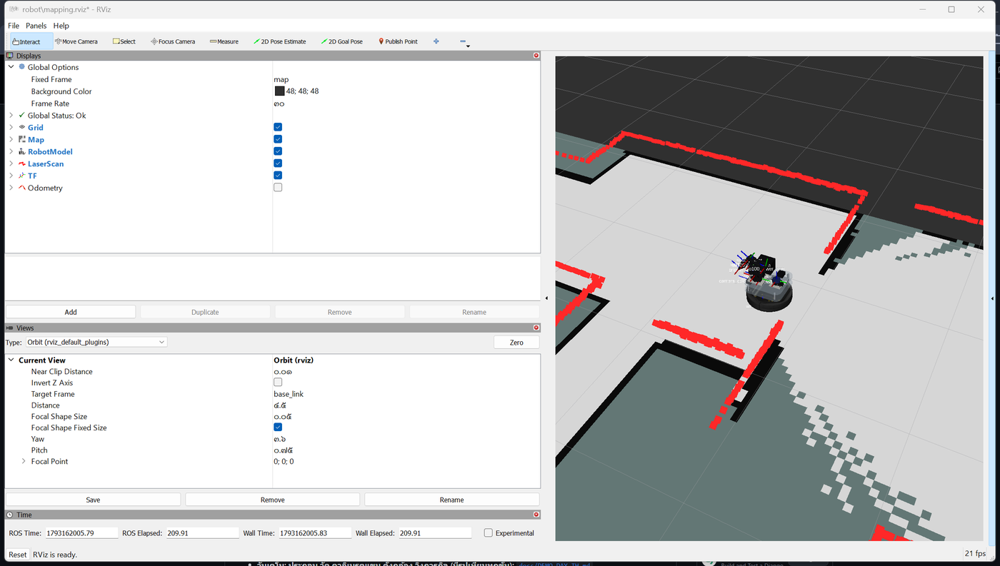
*ออกประตูบน ลงทางเดินขวาไปหา Station 2*

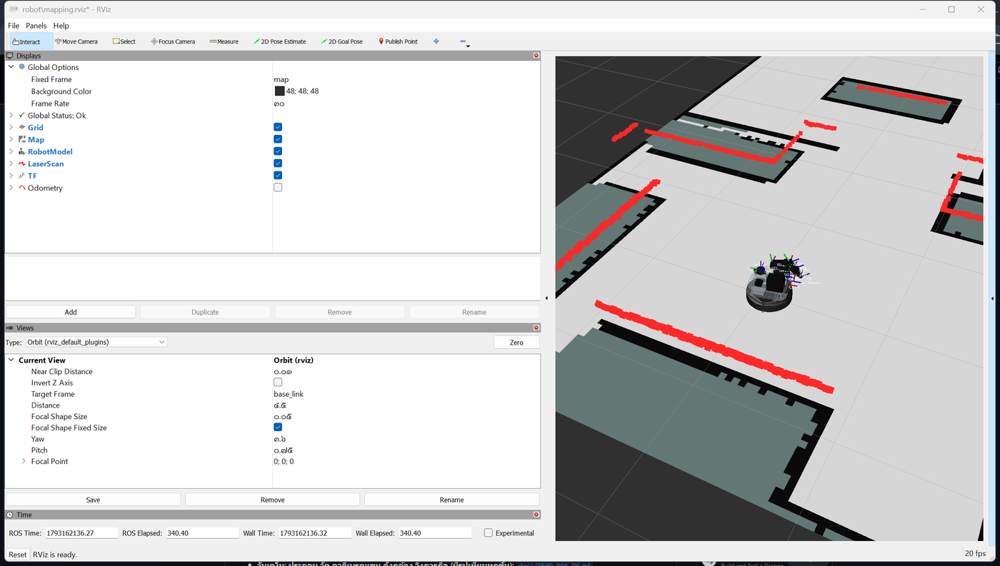
*กลับถึง Initial: กำแพงเส้นเดียวคม ไม่ซ้อนสองชั้น = แผนที่ใช้ได้*

✅ แผนที่ที่เซฟได้จริงจากรอบนี้ (ขาว = ว่าง, ดำ = กำแพง, เทา = ยังไม่เห็น/ใต้โต๊ะ):

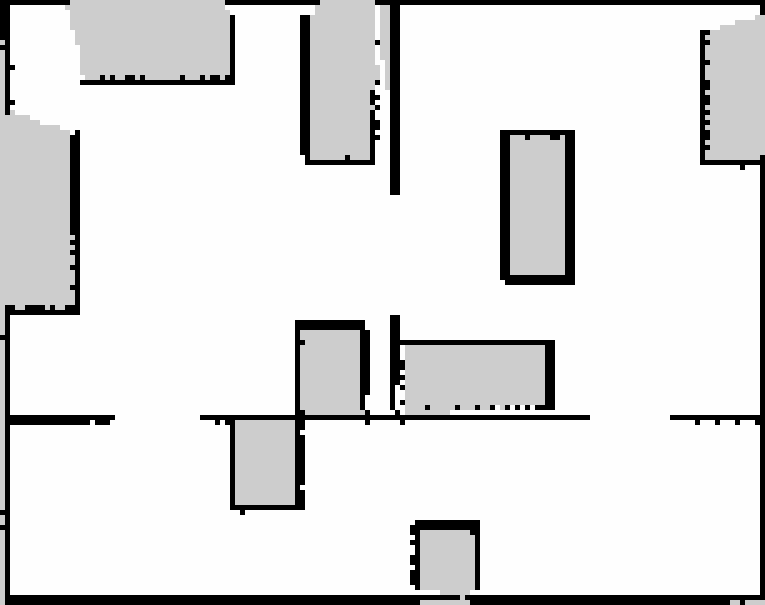
*`practice_map.pgm` จากรอบที่ถ่ายภาพ (153 × 121 ช่อง ช่องละ 5 ซม.)*


---

## ขั้น 5 — หน้าต่าง 6: เซฟแผนที่

| Windows | Ubuntu |
|---|---|
| `mkdir $HOME\maps -Force; pixi run ros2 run nav2_map_server map_saver_cli -f $HOME\maps\practice_map --ros-args -p save_map_timeout:=10.0` | `mkdir -p ~/maps && ros2 run nav2_map_server map_saver_cli -f ~/maps/practice_map --ros-args -p save_map_timeout:=10.0` |

✅ `Map saved successfully` และได้ 2 ไฟล์ในโฟลเดอร์ `maps`: `practice_map.pgm` (รูป) + `practice_map.yaml` (ค่าตั้ง)

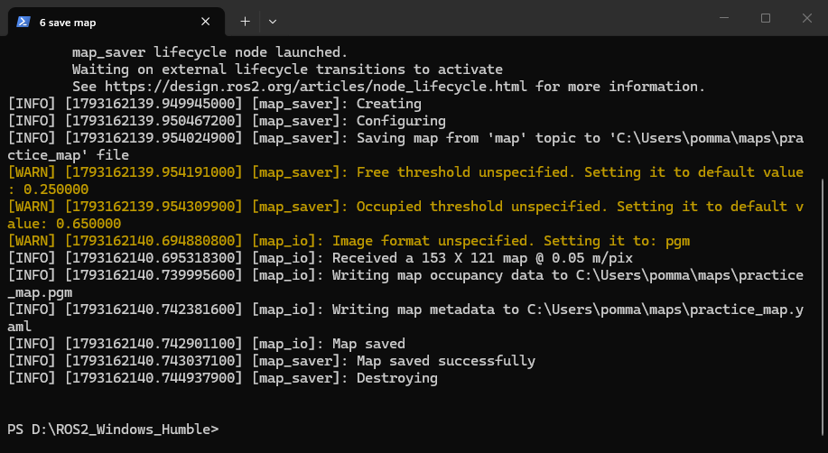
*บรรทัดเหลือง `threshold unspecified` / `Image format unspecified` = ปกติ · ต้องจบด้วย `Map saved successfully`*

❌ ถ้าขึ้นแดง `Failed to spin map subscription` = หา `/map` ไม่ทันเวลา: เช็คว่าหน้าต่าง 4 (SLAM) ยังเปิดอยู่ และพิมพ์ `--ros-args -p save_map_timeout:=10.0` ท้ายคำสั่งครบ แล้วรันใหม่

แล้ว **ปิด** ด้วย `Ctrl+C`: หน้าต่าง 5 (คีย์บอร์ด) → หน้าต่าง 4 (SLAM) → ปิด RViz (หน้าต่าง 3)
หน้าต่าง 1 กับ 2 ยังเปิดไว้

> ทำไมต้องปิด SLAM: ขั้นต่อไป Nav2 มีตัวหาตำแหน่งของมันเอง (AMCL) ถ้าเปิดพร้อมกัน ตำแหน่งหุ่นจะกระโดดไปมา

---

## ขั้น 6 — Nav2: ให้หุ่นวิ่งเอง

**หน้าต่าง 1: เปิดหุ่นปลอมใหม่** (`Ctrl+C` แล้วรันคำสั่งเดิมจากขั้น 1) หุ่นจะกลับมาที่ Initial ลูกบาศก์กลับที่เดิม

**หน้าต่าง 4: Nav2** (ใช้แผนที่ที่เพิ่งเซฟ)

| Windows | Ubuntu |
|---|---|
| `pixi run ros2 launch robot\nav2.launch.py map:=$HOME\maps\practice_map.yaml` | `ros2 launch ./nav2.launch.py map:=$HOME/maps/practice_map.yaml` |

✅ รอ ~10 วินาที บรรทัดท้าย ๆ ต้องมี `[bt_navigator]: Activating`
ช่วงแรกมี `Timed out waiting for transform ...` ไม่กี่บรรทัด = ปกติ · ถ้าแผนที่ตัวเองเละ ลบ `map:=...` ออก (ใช้แผนที่สำเร็จรูปใน repo)

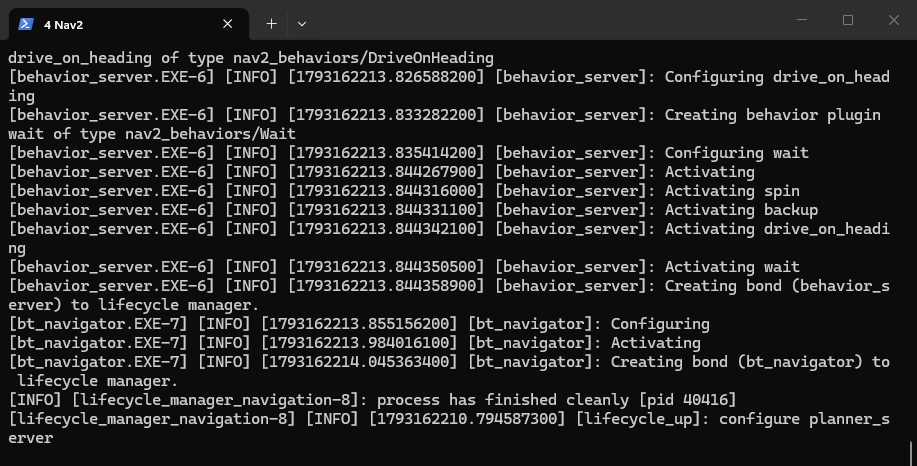
*หน้าต่าง 4 (Nav2) หลังพร้อม: มี `[bt_navigator]: Activating` และ `Creating bond` ไม่มีบรรทัดแดงรัว ๆ*

**หน้าต่าง 3: RViz สำหรับภารกิจ**

| Windows | Ubuntu |
|---|---|
| `pixi run rviz2 -d robot\mission.rviz` | `rviz2 -d mission.rviz` |

✅ เห็นแผนที่ + ขอบสีรอบกำแพง (costmap) + วงแดง Station + ช่อง **Camera** มุมล่างซ้าย (ยังว่าง เพราะยังไม่เปิดกล้อง)
ถ้าจุดแดงเลเซอร์ไม่ทับกำแพง: กด **2D Pose Estimate** แล้วคลิกที่ตำแหน่งหุ่น ลากไปทางที่หุ่นหัน

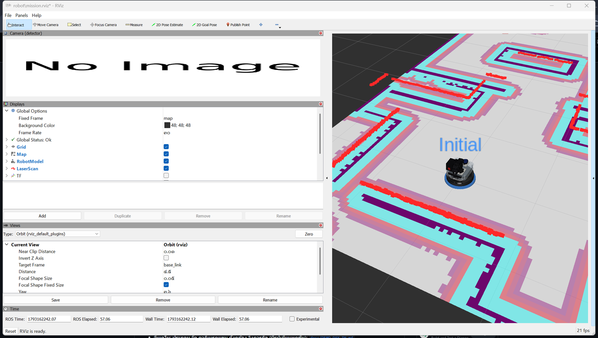
*RViz (`mission.rviz`) ตอน Nav2 พร้อม: หุ่นที่ Initial · ขอบฟ้า/ชมพู/ม่วงรอบกำแพง = costmap (เขตที่ Nav2 ไม่ให้เข้าใกล้) · จุดแดงทับเส้นกำแพงพอดี = AMCL รู้ตำแหน่งถูก · ช่อง Camera ด้านบนยัง `No Image` เพราะยังไม่เปิดกล้อง*

**ลองสั่งด้วยมือ:** กด **2D Goal Pose** คลิกกลางห้องบน ค้างแล้วลากเป็นทิศ
✅ เส้นเขียวขึ้น หุ่นวิ่งตามเส้นเอง หน้าต่าง 4 ขึ้น `Reached the goal!` · สั่งกลับไปแถว Initial ด้วยวิธีเดียวกัน

---

## ขั้น 7 — หน้าต่าง 5: ซ้อมวิ่งครบรอบ (ยังไม่ใช้กล้อง/แขน)

**เปิดหน้าต่าง 1 ใหม่อีกครั้ง** ให้หุ่นกลับ Initial (ถ้าเพิ่งสั่งวิ่งเล่นในขั้น 6) แล้ว:

| Windows | Ubuntu |
|---|---|
| `pixi run python robot\mission_nav2.py --nav-only` | `python3 mission_nav2.py --nav-only` |

✅ ต้องเห็น (ประมาณ 3 นาที):
```
[INIT] robot is at Initial Location - telling AMCL and waiting for Nav2
[NAV_STATION1] go to STATION1 x=4.65 y=1.32 yaw=180 deg
[NAV_STATION1] arrived in .. s
[NAV_STATION2] go to STATION2 x=2.85 y=-2.25 yaw=90 deg
[NAV_STATION2] arrived in .. s
[RETURN_HOME] go to HOME x=0.00 y=0.00 yaw=0 deg
Mission finished: succeeded in ... s
```
สังเกต: หุ่นไปจอด**ห่างลูกบาศก์ 0.65 ม. แล้วหันท้ายเข้าหา** (yaw=180) เพราะแขนกับกล้องอยู่ด้านหลังหุ่น

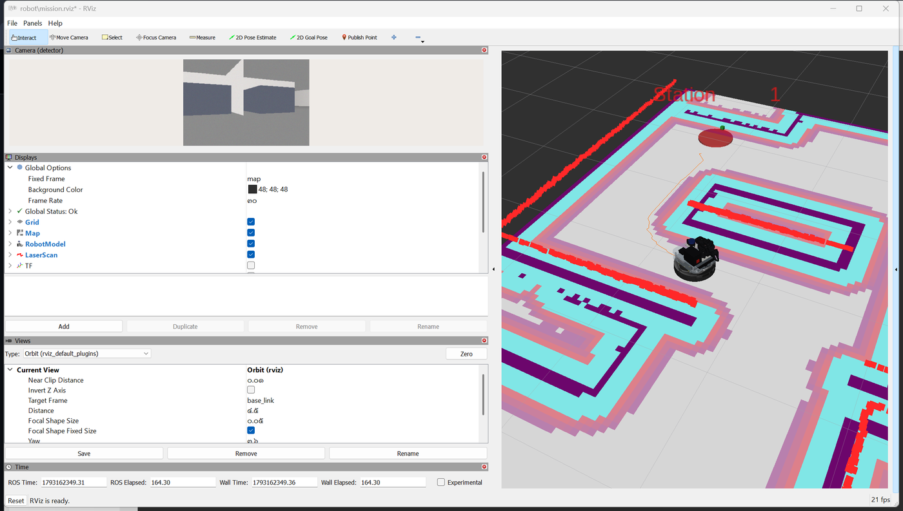
*ระหว่างวิ่งไป Station 1: เส้นสีส้ม = เส้นทางที่ Nav2 วางไว้ ไปจบที่วงแดง Station 1 (จุดเขียวเล็ก = ลูกบาศก์) (ภาพจากรอบภารกิจเต็ม เส้นทางเหมือน --nav-only)*

---

## ขั้น 8 — กล้องปลอม + ตัวหาวัตถุ

**หน้าต่าง 6: กล้องปลอม** (ถ่ายภาพห้องจำลองจากตำแหน่งกล้องบนหุ่น มองออกท้าย)

| Windows | Ubuntu |
|---|---|
| `pixi run python robot\fake_camera.py` | `python3 fake_camera.py` |

✅ `Fake Xtion ready: /camera/color/image_raw (640x480) ...`

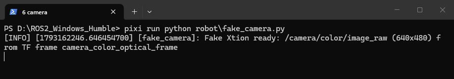
*หน้าต่าง 6: กล้องปลอมพร้อม*

**หน้าต่าง 7: ตัวหาวัตถุ**

| Windows | Ubuntu |
|---|---|
| `pixi run python robot\cube_detector.py` | `python3 cube_detector.py` |

✅ `Cube detector on /camera/color/image_raw, objects on a surface 0.00 m high`

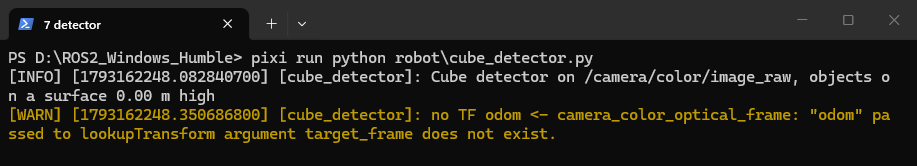
*หน้าต่าง 7: ตัวหาพร้อม (`objects on a surface 0.00 m high` = วัตถุอยู่บนพื้น)*
ตอนนี้หุ่นอยู่ Initial กล้องยังไม่เห็นลูกบาศก์ (ไกล 5 ม.) เป็นเรื่องปกติ ช่อง Camera ใน RViz เห็นห้องจากท้ายหุ่น


*ช่อง Camera (ซ้ายบนของ RViz) มีภาพแล้ว: เห็นห้องด้านหลังหุ่น · ภาพเล็ก ลากขอบช่องให้ใหญ่ขึ้นได้*

ตอนหุ่นจอดหน้า Station 1 (ขั้น 10) ภาพจะเป็นแบบนี้: ลูกบาศก์อยู่ล่างภาพ กรอบแดง = ตัวหาเจอ

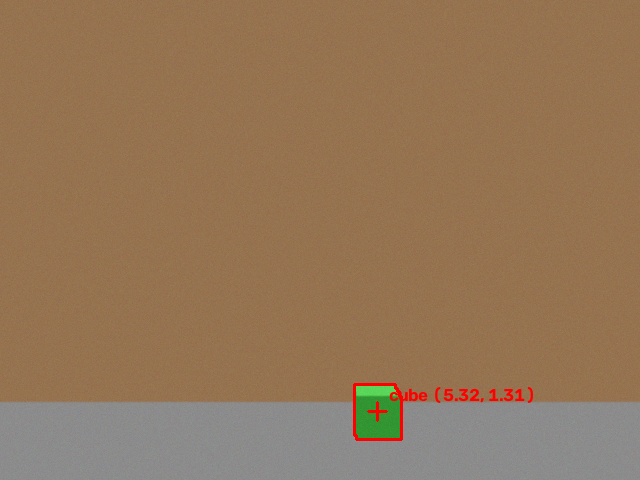

---

## ขั้น 9 — หน้าต่าง 8: ลองสั่งแขนเอง

ดูแขนใน RViz ไปด้วย พิมพ์ทีละบรรทัด:

| Windows (`pixi run python robot\arm_control.py ...`) | แขนต้องทำ |
|---|---|
| `open` | อ้าปากคีบ |
| `reach -0.27 0.0 0.10` | เอื้อม**ออกท้ายหุ่น** ให้กลางปากคีบไปอยู่หลังกลางหุ่น 27 ซม. สูงจากพื้น 10 ซม. |
| `close` | หุบ |
| `carry` | ยกขึ้นท่าถือของ |
| `rest` | พับเก็บ |

(Ubuntu: `python3 arm_control.py open` ฯลฯ)
✅ ทุกคำสั่งจบด้วย `done` · x ติดลบ = หลังหุ่น · แขนเอื้อมถึงพื้นได้ที่ x = −0.20 ถึง −0.32 ม. นอกช่วงนี้ขึ้น `out of reach`

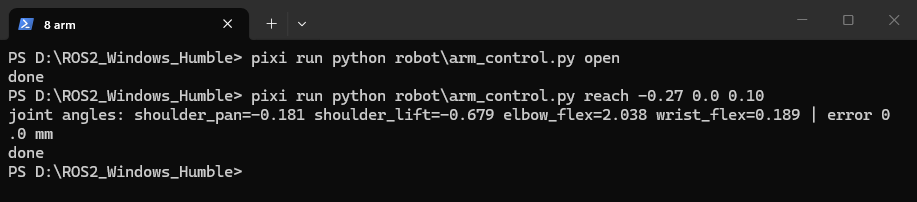
*หน้าต่าง 8: `open` แล้ว `reach -0.27 0.0 0.10` แต่ละคำสั่งจบด้วย `done`*

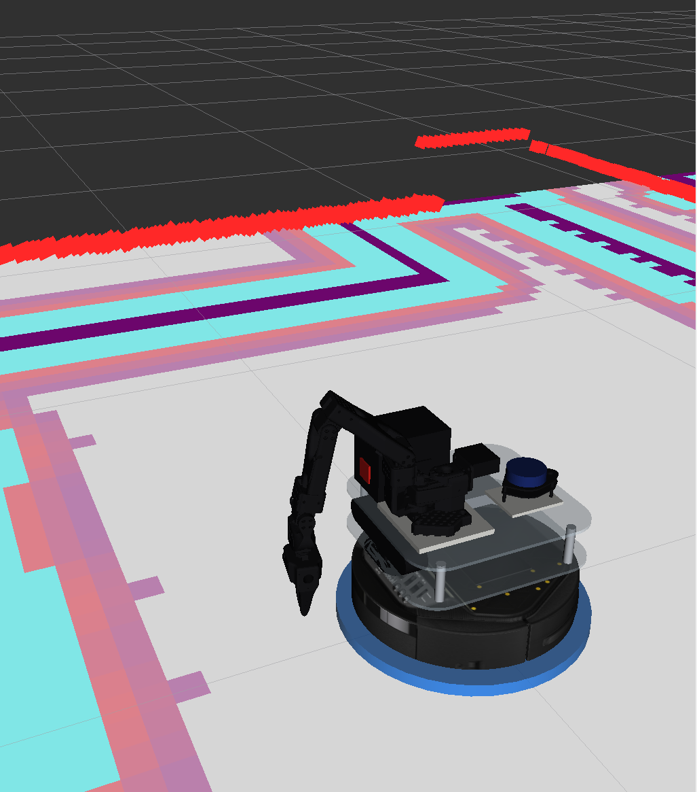
*RViz ซูมเข้าไปที่หุ่น: แขนเอื้อมออก**ท้าย**หุ่น ปากคีบอ้า สูงจากพื้น 10 ซม.*

---

## ขั้น 10 — หน้าต่าง 5: ภารกิจเต็ม 🎯

**เปิดหน้าต่าง 1 ใหม่** (หุ่นกลับ Initial ลูกบาศก์กลับ Station 1) รอ 3 วินาที แล้ว:

| Windows | Ubuntu |
|---|---|
| `pixi run python robot\mission_nav2.py` | `python3 mission_nav2.py` |

✅ ผลจริงจากเครื่องทีม (28 ต.ค.) ใช้เวลาประมาณ 4 นาที:
```
[INIT] Nav2 is active - folding the arm
[NAV_STATION1] go to STATION1 x=4.65 y=1.32 yaw=180 deg
[NAV_STATION1] arrived in 57 s
[DETECT_OBJECT] cube at x=5.301 y=1.322 (odom) = -0.64 m ahead, +0.15 m left of the robot
  approach: cube is 0.65 m behind, driving -0.38 m
  cube is now too close for the camera - using where it was seen before
[PICK] cube at -0.273 +0.006 0.020 (base_link) - moving the arm
[PICK] done
[NAV_STATION2] go to STATION2 x=2.85 y=-2.25 yaw=90 deg
[DETECT_STATION] station at x=2.858 y=-2.908 (odom) = -0.61 m ahead, +0.17 m left of the robot
  approach: station is 0.64 m behind, driving -0.37 m
[PLACE] station at -0.273 +0.006 0.000 (base_link) - moving the arm
[PLACE] done
[RETURN_HOME] arrived in 64 s
Mission finished: succeeded in 229 s
```
("ahead" ติดลบ = วัตถุอยู่หลังหุ่น ถูกต้อง เพราะกล้องมองออกท้าย)

หน้าต่าง 1 ต้องขึ้น:
```
Cube grabbed (jaw centre 0.2 cm from cube centre)
Cube released at x=2.858 y=-2.909 z=0.020 - on the Station 2 marker
```

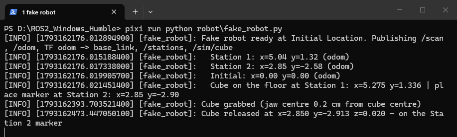
*หน้าต่าง 1 หลังจบ: `Cube grabbed` และ `Cube released ... on the Station 2 marker`*

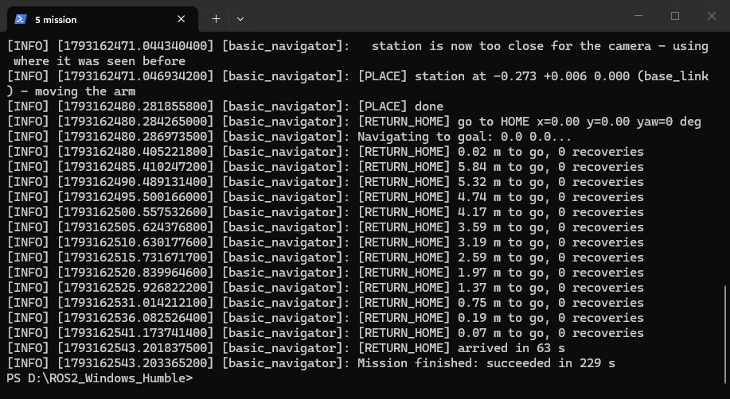
*หน้าต่าง 5 ท้ายสุด: `[RETURN_HOME] arrived` แล้ว `Mission finished: succeeded in 229 s`*

ลำดับที่หุ่นทำ: จอดหน้า Station 1 ท้ายหันเข้า → กล้องหาลูกบาศก์ → **ถอย**เข้าไปจนลูกบาศก์ห่าง 0.27 ม. → แขนเอื้อมออกท้าย หยิบ → ขับออก 0.2 ม. พับแขนถือของ → ไป Station 2 ทำแบบเดียวกันแต่วาง → กลับบ้าน

ดูทีละช่วงจากรอบจริง (ซูมเข้าไปที่หุ่นใน RViz เพื่อดูแขน):

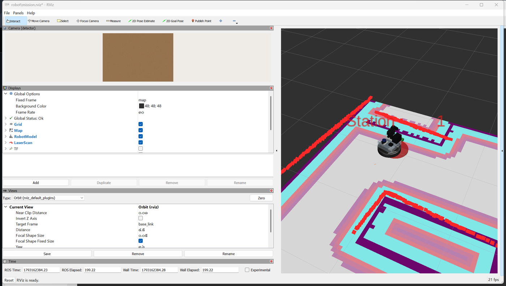
*1) จอดหน้า Station 1 ท้ายหุ่นหันเข้าหาวงแดง (`[DETECT_OBJECT] cube at ...`)*

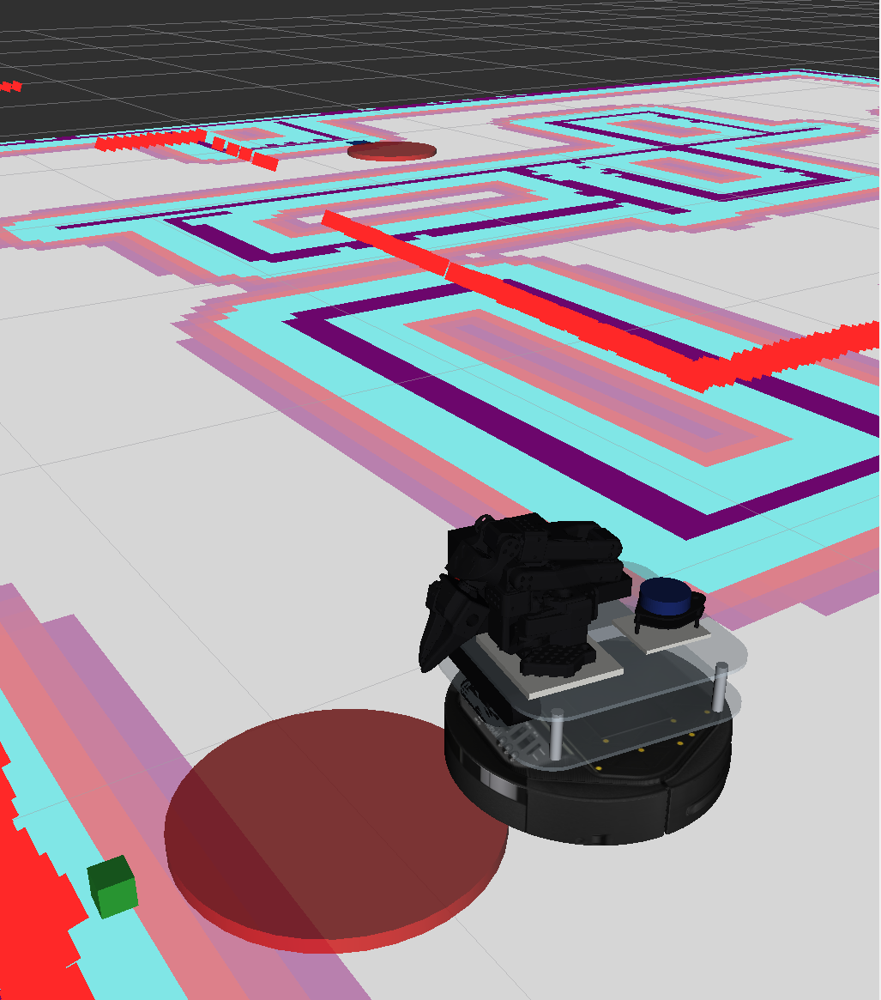
*2) มุมใกล้: ลูกบาศก์เขียวอยู่หลังหุ่น ~0.65 ม. หุ่นกำลังจะถอยเข้าไป*

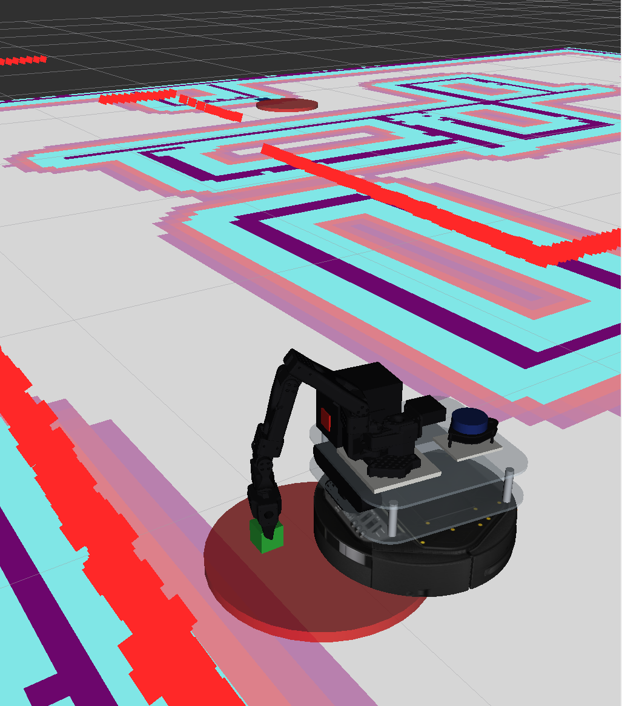
*3) ถอยจนลูกบาศก์ห่าง 0.27 ม. แล้วแขนเอื้อมออกท้ายลงไปที่ลูกบาศก์ (`[PICK] cube at -0.273 ...`)*

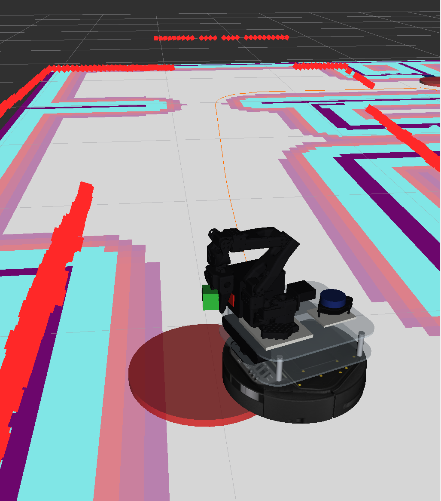
*4) หนีบแล้วยกขึ้น*

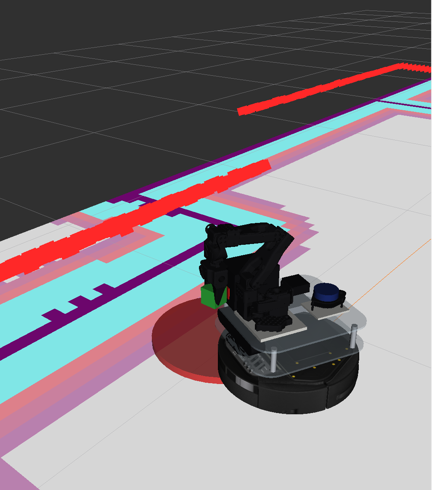
*5) ขับออก 0.2 ม. พับแขนท่าถือของ (`[PICK] done`)*

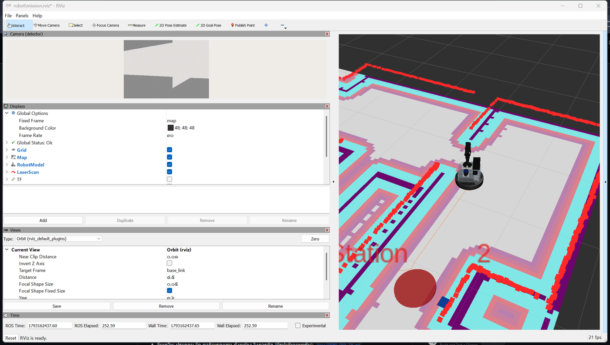
*6) ถือลูกบาศก์วิ่งไป Station 2 ตามเส้นสีส้ม*

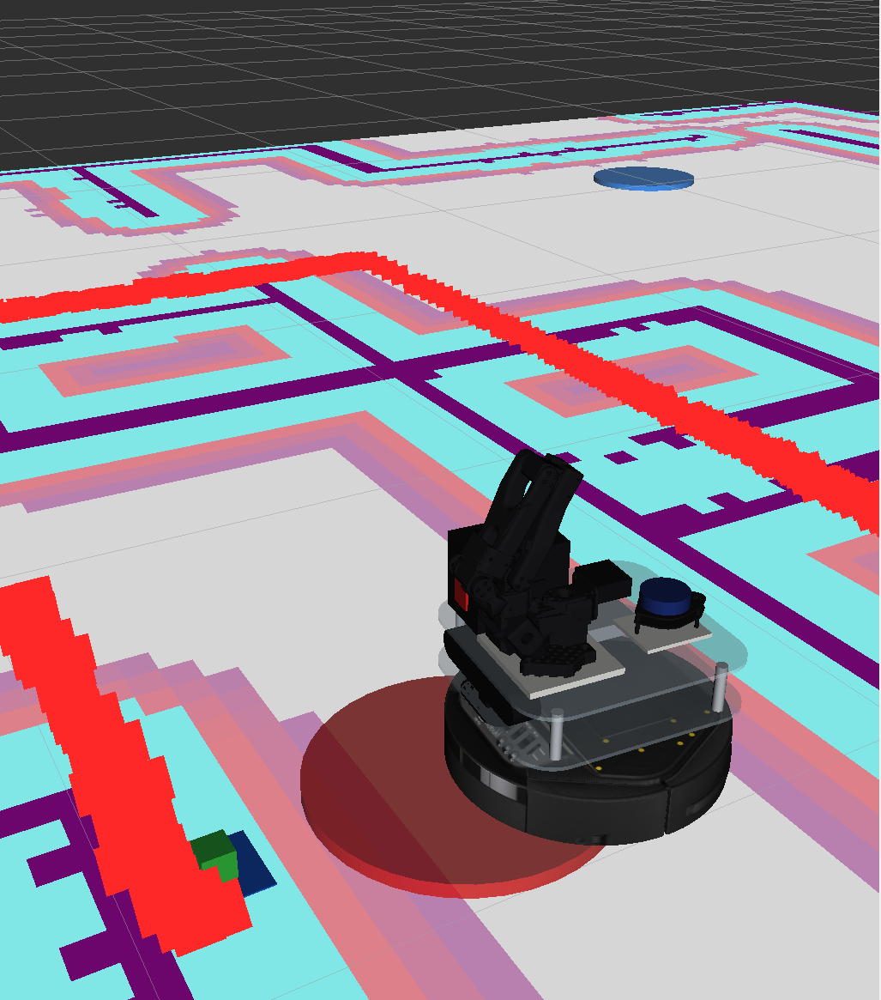
*7) ถอยเข้าหาแผ่นฟ้า แขนวางลูกบาศก์ (`[PLACE] station at ...`)*

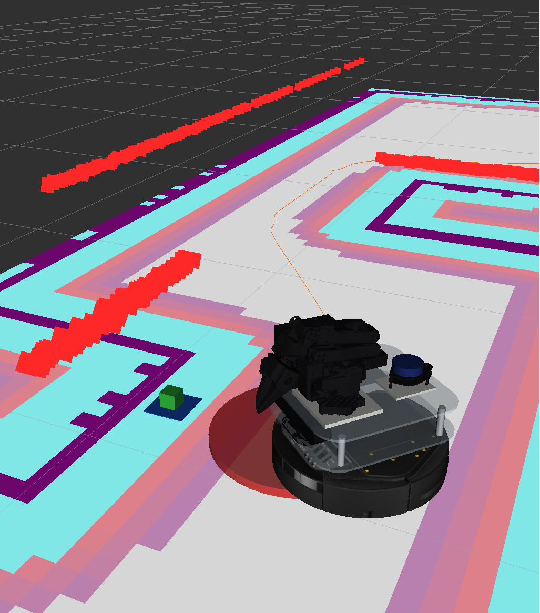
*8) วางเสร็จ ลูกบาศก์อยู่บนแผ่นฟ้า (`[PLACE] done`)*

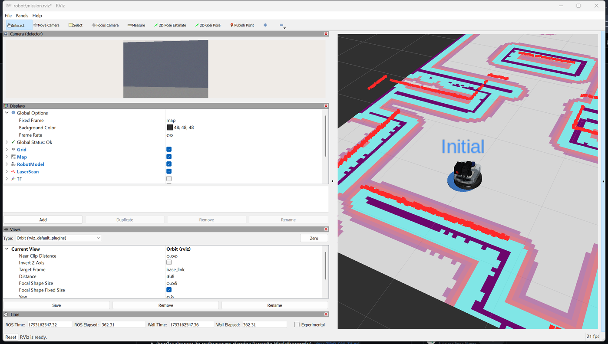
*9) กลับถึง Initial (`Mission finished: succeeded`)*

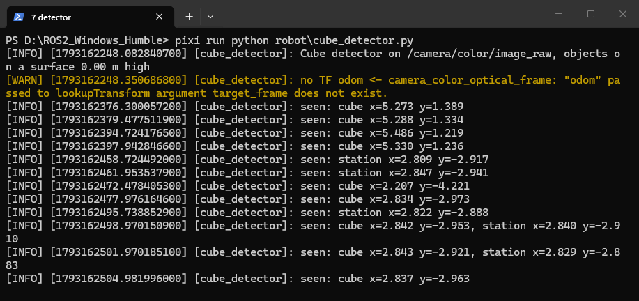
*หน้าต่าง 7 ระหว่างภารกิจ: `seen: cube x=... y=...` / `seen: station ...` ทุก ~3 วินาทีเมื่อกล้องเห็น · บรรทัดเหลือง `no TF odom <- camera_color_optical_frame` ตอนเพิ่งเปิด (ก่อน Nav2 พร้อม) = ปกติ*

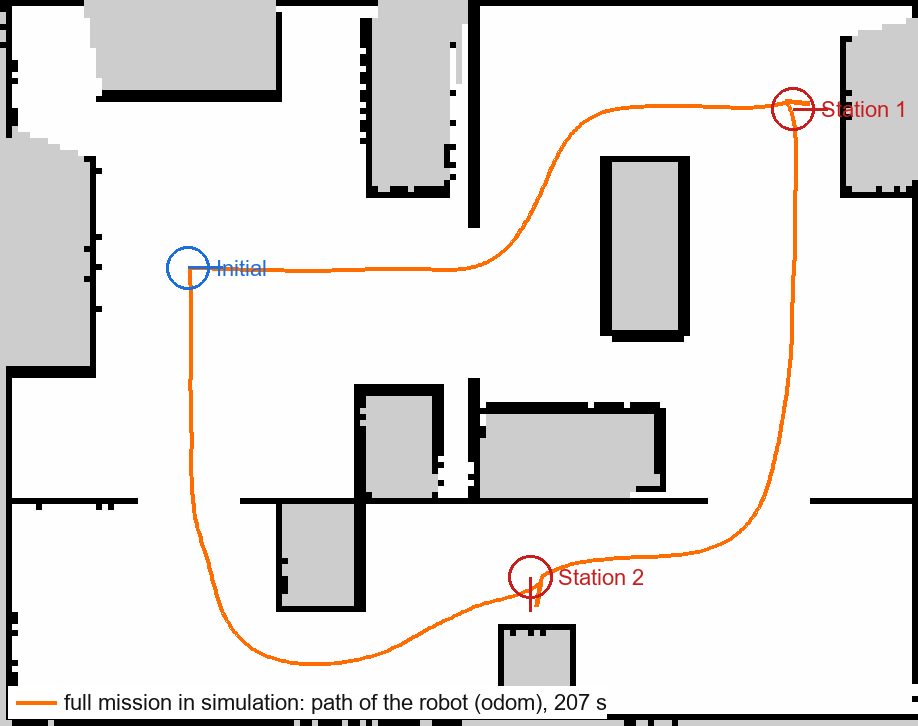

**อยากซ้อมอีกรอบ:** เปิดหน้าต่าง 1 ใหม่ (ลูกบาศก์กลับที่เดิม) แล้วรันหน้าต่าง 5 ซ้ำ ไม่ต้องปิดหน้าต่างอื่น

---

## ขั้น 11 — ซ้อมเครื่องมือวันเดโม (ไม่ต้องมีของจริง)

วันจริงมีเครื่องมืออีก 4 ตัว ลองในซิมได้หมด จะได้ไม่ตื่นเต้นหน้างาน

**ก) คาลิเบรตแขน (แขนจำลอง)** — หน้าต่าง 8:
```powershell
pixi run python robot\so100_calibrate.py --mock
```
✅ ขึ้น 3 ท่า (REST, HOME, PAN_90) แล้วท้ายสุดทุกข้อ `sign ok  zero error` ไม่เกิน ±2 deg
ดูรูปท่าจริงที่ต้องจัดด้วยมือใน [DEMO_DAY_TH.md](DEMO_DAY_TH.md) ขั้น 5.2

**ข) ไดรเวอร์แขนจริง กับเซอร์โวจำลอง** — แทนแขนปลอม:
1. หน้าต่าง 2: `Ctrl+C` แล้วเปิดใหม่ด้วย `arm:=none` แทน `arm:=sim`
2. หน้าต่าง 8: `pixi run python robot\so100_driver.py --ros-args -p mock:=true`
   ✅ `SO-100 ready (MOCK - no real arm), supply 7.4 V, torque on, holding: ...`
3. ลองขั้น 9 ซ้ำ (ใช้หน้าต่างใหม่อีกอัน) หรือภารกิจเต็มขั้น 10 อีกรอบ (ผลจริง: `succeeded in 232 s`)
4. ซ้อมเสร็จ: `Ctrl+C` หน้าต่าง 8 แล้วเปิดหน้าต่าง 2 กลับเป็น `arm:=sim`

**ค) หาสีวัตถุ** — ให้หุ่นอยู่จุดที่กล้องเห็นลูกบาศก์ก่อน (หน้าต่าง 1: `pixi run python robot\fake_robot.py --ros-args -p start_pose:=[4.65,1.32,3.14159]`) แล้วหน้าต่าง 8:
```powershell
pixi run python robot\hsv_tuner.py
```
กด `1` คลิกลูกบาศก์ → ภาพขวาเป็นก้อนขาว · กด `2` คลิกแผ่นฟ้า (ถ้าเห็น) · กด `q` → ได้บรรทัด `-p cube_hsv_low:=[...] ...`

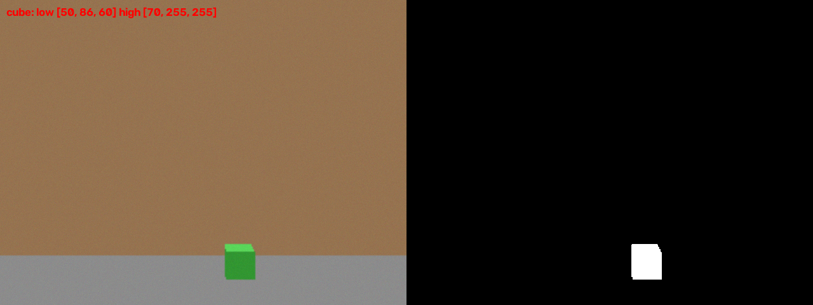

**ง) เช็คมุมกล้องด้วยตลับเมตร (แกล้งให้กล้องก้ม 5° เอียง 2°)**
1. หน้าต่าง 6: `Ctrl+C` แล้ว `pixi run python robot\fake_camera.py --ros-args -p "real_camera_rpy:=[0.0,0.087,3.18]"`
2. หน้าต่าง 1 ยังเริ่มที่ `start_pose:=[4.65,1.32,3.14159]` (จากข้อ ค) ดูบรรทัด `Cube on the floor at Station 1: x=A y=B`
3. ระยะลูกบาศก์จากกลางหุ่น (หุ่นหันหลังให้): x = 4.65 − A, y = 1.32 − B เช่น A=5.327 B=1.306 → x = −0.677, y = 0.014
4. หน้าต่าง 8: `pixi run python robot\camera_check.py -0.677 0.014 --write` (ใส่ค่าของคุณ)
   ✅ `off by` ประมาณ 15–20 cm และ `camera is tilted` ประมาณ `+5 deg more down and turned +2 deg more left` (= ที่แกล้งไว้)
5. หน้าต่าง 2: `Ctrl+C` แล้วเปิดใหม่ (โหลด URDF ที่แก้แล้ว) → รันข้อ 4 อีกครั้ง **ไม่ใส่** `--write`
   ✅ `off by 0.1 cm` / `good enough (< 1 cm)`
6. **คืนไฟล์ URDF เดิม** (สำคัญ ไม่งั้นรอบหน้ากล้องจะเอียง): ในโฟลเดอร์โปรเจกต์ `git checkout -- robot/kobuki_x2.urdf` แล้วเปิดหน้าต่าง 2 ใหม่ และเปิดหน้าต่าง 6 ใหม่แบบปกติ (ไม่มี `real_camera_rpy`)

---

## ขั้น 12 — ปิดระบบ

`Ctrl+C` ตามลำดับ: **5 ภารกิจ → 7 ตัวหา → 6 กล้อง → 4 Nav2 → 1 หุ่นปลอม → 2 โมเดล → ปิด RViz**
(วันจริง: ปิดหน้าต่างที่สั่งล้อก่อน แล้วค่อยปิดไดรเวอร์ Kobuki)

---

## ถ้าติด

| อาการ | แก้ |
|---|---|
| `ros2: command not found` (Ubuntu) | `source /opt/ros/humble/setup.bash` |
| RViz ไม่ขึ้นหุ่น / `No transform` | เช็คหน้าต่าง 1 และ 2 เปิดอยู่ · ขั้น 4 ต้องเปิด SLAM ก่อน RViz |
| กดปุ่มแล้วหุ่นไม่เดิน | คลิกหน้าต่าง 5 ก่อน + เปลี่ยนแป้นเป็นภาษาอังกฤษ |
| แผนที่ซ้อนเบลอ | ขับ/หมุนช้าลง เริ่มใหม่: ปิด-เปิดหน้าต่าง 1 และ 4 |
| เซฟแผนที่แล้วขึ้น `Failed to spin map subscription` | หน้าต่าง 4 (SLAM) ต้องยังเปิด · ท้ายคำสั่งต้องมี `--ros-args -p save_map_timeout:=10.0` |
| `ros2 node list` ว่าง/ค้าง | `ros2 daemon stop` แล้ว `ros2 daemon start` |
| Nav2 ขึ้น `Timed out waiting for transform` ไม่หยุด | หน้าต่าง 1 หรือ 2 ไม่ได้เปิด · หรือ SLAM ยังเปิดค้าง (ต้องปิด) |
| เลเซอร์ไม่ทับกำแพงใน RViz | กด 2D Pose Estimate ที่ตำแหน่งหุ่น |
| `mission_nav2.py` ค้างที่ `Waiting for amcl_pose` | รอ Nav2 ขึ้น `Activating` ก่อน |
| `[DETECT_OBJECT] no cube in the camera image` | หน้าต่าง 6 หรือ 7 ไม่ได้เปิด · ลูกบาศก์ถูกย้ายไปแล้วจากรอบก่อน → เปิดหน้าต่าง 1 ใหม่ |
| แขนไม่ขยับเลย | หน้าต่าง 2 ต้องมี `arm:=sim` (หรือเปิด `so100_driver.py` ถ้าใช้ `arm:=none`) |
| กล้องเห็นแต่ตำแหน่งเพี้ยนหลังทำขั้น 11 ง | ยังไม่ได้คืน URDF: `git checkout -- robot/kobuki_x2.urdf` |

ตารางเต็มอยู่ใน [PRACTICE_NO_ROBOT_TH.md](PRACTICE_NO_ROBOT_TH.md) หัวข้อ "ปัญหาที่เจอบ่อย"

---

## เช็คลิสต์จบวันซ้อม

- [ ] ขั้น 3: `/scan` ~4 Hz, `/odom` ~50 Hz, LiDAR `[0.075, -0.035, 0.247]`
- [ ] ขั้น 4–5: ขับวนครบห้อง แผนที่ไม่ซ้อน เซฟได้ `.pgm` + `.yaml`
- [ ] ขั้น 6: กด 2D Goal Pose แล้วหุ่นวิ่งไปเอง
- [ ] ขั้น 7: `--nav-only` จบ `succeeded` หุ่นจอดหันท้ายเข้า Station
- [ ] ขั้น 8: ช่อง Camera ใน RViz มีภาพ
- [ ] ขั้น 9: `reach -0.27 0.0 0.10` แขนเอื้อมออกท้ายจริง
- [ ] ขั้น 10: ภารกิจเต็ม `succeeded` และหน้าต่าง 1 ขึ้น `on the Station 2 marker`
- [ ] ขั้น 11: ลองครบ ก–ง และคืน URDF แล้ว

ทำได้ครบ = พร้อมวันเดโม ต่อด้วย [DEMO_DAY_TH.md](DEMO_DAY_TH.md) (ประกอบ วัด คาลิเบรตแขนจริง ตั้งกล้องจริง)
